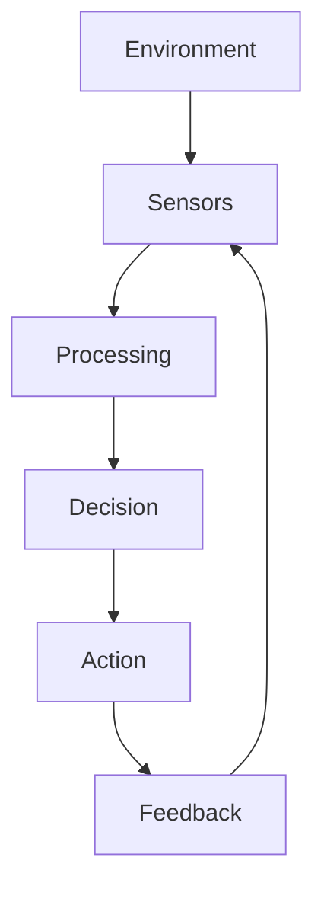

# Copying and rendering diagrams

MarkMind renders Mermaid source blocks using Mermaid's own layout engine, so new diagram types and arbitrary connections do not need diagram-specific code. Flowcharts, sequences, state/class/entity diagrams, pie charts, mindmaps, timelines, Gantt charts, and other types supported by the installed Mermaid version use the same rendering pipeline.

## From ChatGPT

Paste a selected response directly into the editor. When its rich clipboard contains Mermaid source or a rendered Mermaid SVG, MarkMind preserves every diagram in document order, along with headings, prose, lists, tables, links, and code. Source is preferred when it is available; SVG preserves the original geometry and colors when source is absent. Imported diagrams remain vector SVGs in the preview and Word export.

A downloaded or plain-text Markdown copy sometimes contains only `#chatgpt-mermaid-...` styles and concatenated labels. The CSS can identify a diagram family and its appearance, but the arrows and node coordinates are absent. Changing CSS cannot recover that missing graph.

For recognizable flowchart copies, **Reconstruct diagrams** appears above the editor. Enter a Gemini API key, then choose the button to infer connections from the heading, nearby prose, and copied labels. The application sends that text directly to Google; it does not send the stylesheet or the API key to an application server. The key stays in memory for the current session and can be cleared. Typing and previewing do not make model requests. The default model is `gemini-2.5-flash`; model settings allow another Gemini model available to your account. A working key and model quota are required.

Reconstruction produces editable fenced Mermaid and marks each result **AI reconstruction — review connections** in the document and exports. It validates that the original labels are retained and that all connections refer to valid nodes. This validation cannot prove that inferred arrows match the original diagram: multiple graphs can have the same copied text. Review the result, especially for labels without explanatory prose. There are no heading-specific graph templates or automatic chain layouts.

All eligible diagrams are reconstructed together. Cancellation, a failed request, or an edit during reconstruction preserves the original document. **Undo reconstruction** restores the original copy while the generated document is unedited. Non-flowchart CSS-only copies still need Mermaid source or SVG; the model recovery path does not claim to reconstruct sequence, class, or chart geometry from styling alone.

For the original connections and positions, copy the rendered response with rich HTML containing its SVG, ask for fenced Mermaid source, or use a diagram image. A screenshot alone is not an editable diagram definition. Source and SVG rendering do not require a Gemini key.

## Mermaid source

````markdown

````

The `chatgpt-mermaid` language alias also accepts Mermaid source. Actual SVG markup and clipboard-generated `chatgpt-svg` blocks use a shared sanitizer and responsive inline rendering path. Imported SVG styling is preserved; source diagrams adapt to the selected document theme. SVG scripts, events, embedded frames, and external resource references are removed. Local markers and gradients retain references even when diagrams are duplicated or paginated.

## Verification

Run `npm run typecheck`, `npm run build`, and `npm test`. Install the test browser once with `npx playwright install chromium`, or point `PLAYWRIGHT_CHROMIUM_EXECUTABLE_PATH` at an existing Chromium binary. Browser regressions include the complete provided ChatGPT stylesheet and all three reported label payloads, plus mixed rich paste, malformed input, safe SVG resources, multiple diagram families, and exports. Controlled Gemini responses test integration, cancellation, atomic application, and validation; they do not measure real inference quality. Live reconstruction results and comparisons, when run with a private API key, are reported separately in the PR.
