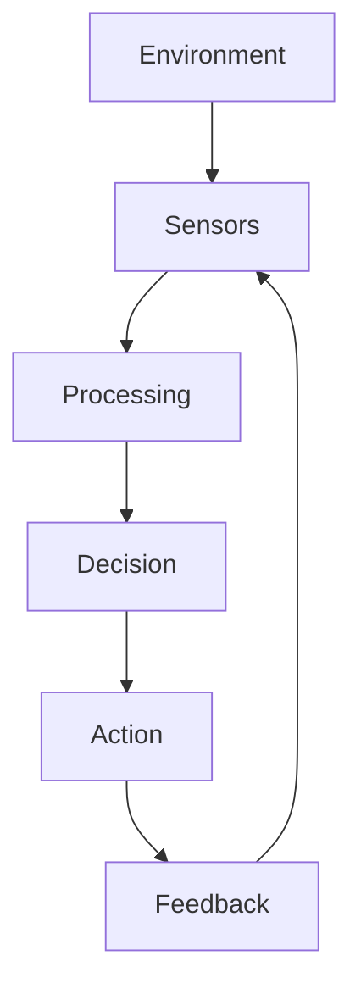

# Copying and rendering diagrams

MarkMind renders Mermaid source blocks using Mermaid's own layout engine, so new diagram types and arbitrary connections do not need diagram-specific code. Flowcharts, sequences, state/class/entity diagrams, pie charts, mindmaps, timelines, Gantt charts, and other types supported by the installed Mermaid version use the same rendering pipeline.

## From ChatGPT

Paste a selected response directly into the editor. When its rich clipboard contains Mermaid source or a rendered Mermaid SVG, MarkMind preserves every diagram in document order, along with headings, prose, lists, tables, links, and code. Source is preferred when it is available; SVG preserves the original geometry and colors when source is absent. Imported diagrams remain vector SVGs in the preview and Word export.

A downloaded or plain-text Markdown copy sometimes contains only `#chatgpt-mermaid-...` styles and concatenated labels. This representation has already lost the arrows, node coordinates, and diagram type. MarkMind shows the available text and a recovery message instead of inventing a diagram. Copy the original rendered response directly with rich HTML, ask for fenced Mermaid source, or use a diagram image. A screenshot alone is not an editable diagram definition.

## Mermaid source

````markdown

````

The `chatgpt-mermaid` language alias also accepts Mermaid source. Actual SVG markup and clipboard-generated `chatgpt-svg` blocks use a shared sanitizer and responsive inline rendering path. Imported SVG styling is preserved; source diagrams adapt to the selected document theme. SVG scripts, events, embedded frames, and external resource references are removed. Local markers and gradients retain references even when diagrams are duplicated or paginated.

## Verification

Run `npm run typecheck`, `npm run build`, and `npm test`. Install the test browser once with `npx playwright install chromium`, or point `PLAYWRIGHT_CHROMIUM_EXECUTABLE_PATH` at an existing Chromium binary. Browser regressions cover mixed rich paste, Markdown recovery, malformed input, safe SVG resources, duplicate IDs, Unicode/HTML labels, multiple Mermaid families, narrow viewport sizing, and print error recovery.
