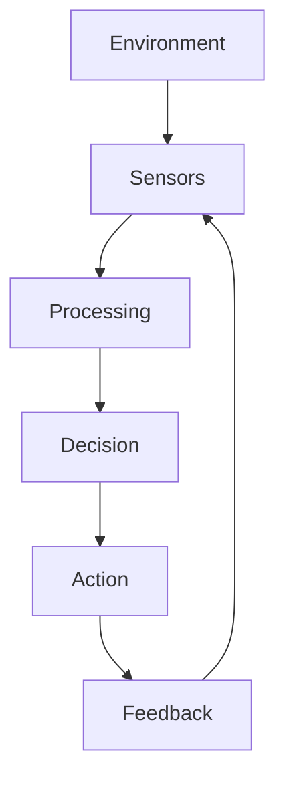

# Copying and rendering diagrams

MarkMind renders Mermaid source blocks using Mermaid's own layout engine, so new diagram types and arbitrary connections do not need diagram-specific code. Flowcharts, sequences, state/class/entity diagrams, pie charts, mindmaps, timelines, Gantt charts, and other types supported by the installed Mermaid version use the same rendering pipeline.

## From ChatGPT

Paste a copied response directly into the editor. When its rich clipboard contains Mermaid source or a rendered Mermaid SVG, MarkMind preserves every diagram in document order, along with headings, prose, lists, tables, links, and code. Source is preferred when it is available; SVG preserves the original geometry and colors when source is absent. Imported diagrams remain vector SVGs in the preview and Word export.

A downloaded or plain-text Markdown copy sometimes contains only `#chatgpt-mermaid-...` styles and concatenated labels. The CSS can identify a diagram family and its appearance, but the arrows and node coordinates are absent. Changing CSS cannot recover that missing graph.

### Checking the Copy response format

ChatGPT's rendered diagrams use SVG elements for node geometry and arrow paths, with a stylesheet for their appearance. The provided CSS contains generic node/edge styling and a diagram-wide ID; it contains no per-node coordinates, edge endpoints, or Mermaid arrow commands. A complete SVG can be rendered faithfully without converting it back into Mermaid.

The native Copy response button's rich clipboard payload still needs to be inspected. Open `/diagram-copy-check.html` in this application, copy the original response in ChatGPT, and paste into the checker. Its report lists clipboard formats, sizes, and SVG/source markers; it stays local until copied. SVG counts can include icons, so positive markers require inspecting the original payload before claiming that complete geometry is available. The report guides that investigation; absent SVG/source markers can identify copies that already lost diagram data.

When both source and rendered SVG are present in one unambiguous diagram card, source is preferred regardless of their order. Explanatory prose stays in place, and broad wrappers containing independent diagrams retain all their assets.

For recognizable flowchart copies, **Reconstruct diagrams** appears above the editor. AI is used only to infer connections missing from these damaged copies; Mermaid source and SVG render directly without AI.

The **Configured AI service** option supports a keyless OpenAI-compatible endpoint. The app owner sets `DIAGRAM_API_BASE_URL` on the server (Vercel environment settings, or `.env.local` for Vite development/preview). It must point to a working `/v1` base URL with `/models` and `/chat/completions` endpoints. The browser calls the same-origin `/api/diagram-reconstruction` relay, which avoids HTTPS-to-HTTP mixed-content restrictions. The relay constructs the diagram request itself and accepts no client-selected upstream URL or credentials. No provider address is bundled as a default.

Choosing **Reconstruct diagrams** discovers an available model and submits the heading, nearby prose, and copied labels. Model settings allow a specific model ID, including IDs containing `/`; a configured ID also works when model discovery is unavailable. Typing and previewing make no model requests. If no endpoint is configured or the service is unreachable, the original document is preserved with an actionable error.

**Gemini** remains available in the provider selector. Enter a Gemini API key for the current session, then reconstruct. That option sends the text directly to Google; the stylesheet stays local. The key is kept in memory and can be cleared. The default Gemini model is `gemini-2.5-flash`; another model available to the account can be selected. A working key and model quota are required for this option.

Reconstruction produces editable fenced Mermaid and marks each result **AI reconstruction — review connections** in the document and exports. It validates that the original labels are retained and that all connections refer to valid nodes. This validation cannot prove that inferred arrows match the original diagram: multiple graphs can have the same copied text. Review the result, especially for labels without explanatory prose. There are no heading-specific graph templates or automatic chain layouts.

All eligible diagrams are reconstructed together. Cancellation, a failed request, or an edit during reconstruction preserves the original document. **Undo reconstruction** restores the original copy while the generated document is unedited. Non-flowchart CSS-only copies still need Mermaid source or SVG; the model recovery path does not claim to reconstruct sequence, class, or chart geometry from styling alone.

For the original connections and positions, copy the rendered response with rich HTML containing its SVG, ask for fenced Mermaid source, or use a diagram image. A screenshot alone is not an editable diagram definition. Source and SVG rendering do not require a Gemini key.

## Mermaid source

````markdown

````

The `chatgpt-mermaid` language alias also accepts Mermaid source. Actual SVG markup and clipboard-generated `chatgpt-svg` blocks use a shared sanitizer and responsive inline rendering path. Imported SVG styling is preserved; source diagrams adapt to the selected document theme. SVG scripts, events, embedded frames, and external resource references are removed. Local markers and gradients retain references even when diagrams are duplicated or paginated.

## Verification

Run `npm run typecheck`, `npm run build`, and `npm test`. Install the test browser once with `npx playwright install chromium`, or point `PLAYWRIGHT_CHROMIUM_EXECUTABLE_PATH` at an existing Chromium binary. Browser regressions include the complete provided ChatGPT stylesheet and all three reported label payloads, plus mixed rich paste, malformed input, safe SVG resources, multiple diagram families, and exports. Controlled provider responses test integration, cancellation, atomic application, and validation; they do not measure real inference quality. Live reconstruction results and comparisons require a working configured service or a private Gemini key and are reported separately in the PR. To run against the configured endpoint, set `DIAGRAM_LIVE_PROVIDER=openai` and run `npm test -- tests/diagram-reconstruction-live.spec.ts`; `DIAGRAM_GEMINI_MODEL` can specify the model ID for either provider. For Gemini, provide `DIAGRAM_GEMINI_SECRET_FILE` pointing to a private key file. Never commit keys or test traces containing them.
