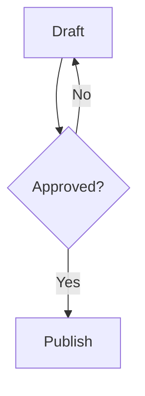

# Chatbot instructions for MarkMind / DocIT Markdown

Copy this entire document into another chatbot, then describe the document you want. The instructions and examples below are self-contained.

## Instructions to the chatbot

Generate a Markdown document for the MarkMind / DocIT editor. Return the document content only, without a conversational introduction or an outer code fence. Use the exact supported syntax below. Keep ordinary text as Markdown; use special blocks only when the requested content needs them. Do not invent front matter, MDX/JSX components, page-break comments, persistent alignment settings, or additional directives.

### Ordinary Markdown

- Use `#` through `######` for headings, blank lines between blocks, `**bold**`, `*italic*`, `~~strike~~`, and backticks for inline code. A single newline inside a paragraph creates a visible line break in this editor.
- Use `-` for unordered lists, `1.` for ordered lists, consistent indentation for nesting, and `- [ ]` / `- [x]` for task lists. Use `>` for quotes.
- Links are `[label](https://example.com)`. Images are ``. Use reachable absolute HTTP(S) URLs when sharing a document; relative URLs resolve against the app's URL. Ordinary Markdown images do not support `data:` URLs.
- GFM tables use a header row and a delimiter row. Use `:---`, `:---:`, or `---:` for left, center, or right column alignment. Escape a cell's literal pipe as `\|`.
- Footnotes use `[^note]` and `[^note]: Explanation.` They become rendered content; DOCX does not create native Word footnote objects.
- `---` creates a horizontal rule, hidden by default in Document settings. It does not break a page.
- Fenced code uses three backticks or tildes and an optional language such as `python`, `typescript`, or `html`. Close with the same character and at least the opening length. An ordinary `html` fence shows source. Code is displayed, not executed. Use longer fences when the example contains shorter fences.
- Escape Markdown punctuation with a backslash when showing it literally. Put special syntax examples in code spans or ordinary code fences so they do not execute.

### Page breaks

Use the exact lowercase marker `[pagebreak]` on its own unindented line at the document root, with blank lines before and after:

```markdown
# Cover

Cover content.

[pagebreak]

# Main content

This begins on a fresh page.
```

The preview and PDF start the following content on a new A4 page. DOCX gets a native Word page break. Automatic pagination still handles overflow. Leading, trailing, and consecutive markers do not create blank pages. Do not use `<!-- pagebreak -->`, `\newpage`, or `---` for a page break.

Page-break markers inside prose, inline code, fenced/indented code, lists, quotes, table cells, columns, or HTML do not execute. Use `\[pagebreak]` to show the literal marker.

### One-block alignment and text formatting

Use `[align - OPTION]` with exactly one alignment option, or `[text - OPTION - OPTION]` to combine formats. Use lowercase keywords/options and separate options with a spaced hyphen (` - `).

| Option | Meaning | Accepted prefix |
| --- | --- | --- |
| `left` | Left align | `align`, `text` |
| `center` | Center align | `align`, `text` |
| `right` | Right align | `align`, `text` |
| `justify` | Justify text | `align`, `text` |
| `bold` | Bold | `text` |
| `italic` | Italic | `text` |
| `underline` | Underline | `text` |
| `strike` | Strikethrough | `text` |
| `highlight` | Yellow text highlight with dark text | `text` |

A standalone prefix applies to the **immediately following one supported block**: paragraph, heading, list, blockquote, or table. Put a blank line between the prefix and its block. A same-line prefix applies to the remaining paragraph text only. For a heading, always put the prefix in its own paragraph before the heading:

```markdown
[align - center]

# Centered heading

[text - right - bold - highlight - underline] A formatted paragraph with *italic words* and [a link](https://example.com).

[align - justify]

This paragraph is justified.

This later paragraph returns to the theme's default alignment.

[text - italic]

> A formatted quote.

[align - right]

- First right-aligned list item.
- Second right-aligned list item.
```

Combine options in a single prefix rather than stacking directive paragraphs. The last conflicting alignment wins; `[text - left - center - bold]` centers and bolds one block. Formatting options can be combined and repeated without toggling them off. Alignment overrides theme defaults. Explicitly aligned GFM table columns keep their own cell alignment.

These prefixes operate at the document root without indentation. Do not place them inside lists, quotes, table cells, columns, HTML, or code. Do not target fenced code/diagrams, display math, a horizontal rule, raw HTML, or another directive. Unknown or malformed options, prefixes before unsupported blocks, and standalone prefixes at the document end remain literal text.

Normal Markdown, links, inline code, and inline math still work in the formatted block. Formatting a list, quote, or table keeps that block's structure. Prefixes are supported in the preview, PDF, and DOCX as native Word alignment/text formatting.

To format only part of a sentence, use `<mark>highlighted words</mark>` and `<u>underlined words</u>`. These semantic tags preserve highlight/underline in both exports and can surround Markdown emphasis. `==highlight==` is not supported. Show literal prefixes with an escaped opening bracket, such as `\[text - bold]`, or in code.

### Mathematics

Use KaTeX expressions with `$...$` for inline math and `$$` on separate lines for display math. Common LaTeX delimiters `\(...\)` and `\[...\]` also work, but explicit dollar delimiters are preferred when generating new content.

```markdown
Inline: $E = mc^2$.

$$
\begin{aligned}
x + y &= 3 \\
x - y &= 1
\end{aligned}
$$
```

Use supported KaTeX commands for fractions, roots, sums, matrices, and aligned equations. Preserve `\\` row separators. Do not generate a complete LaTeX document, packages, or arbitrary macros. Escape literal prices such as `\$5`. PDF shows rendered mathematics; DOCX inserts rendered math images.

### Images with options

The custom image syntax is `[img - option - option - URL]`, with lowercase `img`, spaced-hyphen separators, and the URL last. Image options are case-insensitive, unlike the text-control syntax. Prefer one size and one alignment option; later conflicting size/effect options can replace earlier values. Unknown image options are ignored.

```markdown
[img - full - rounded - shadow - https://example.com/hero.png]
[img - 300x300 - circle - center - https://example.com/avatar.png]
```

- Sizes: `full` (100% width), `half`, `third`, `quarter`, `fit` (100% width, natural height), `cover` (100% width, 320px height, may crop), `semi-cover` (50% width, 200px height), positive `WIDTHxHEIGHT` pixels such as `800x600`, or a positive aspect ratio such as `16:9`.
- Height presets: `480p` = 240px, `720p` = 350px, `1080p` = 450px, `4k` = 600px. These set display height, not source resolution.
- Alignment: `center` (default), `left` or `right` (floats with wrapping text).
- Effects: `rounded`, `circle`, `shadow`, `border`, `grayscale`.
- Defaults: full width, natural height, centered; available width limits oversized images. Custom blocks use alternative text `Image`; use standard Markdown images for descriptive alternative text.

Use real reachable image URLs supplied by the user or omit the image. Do not invent a URL and claim it exists. Cross-origin image restrictions can prevent Word image conversion.

### Diagrams

Use one of these special lowercase fence languages when a diagram is requested:

| Fence | Body |
| --- | --- |
| `mermaid` or `chatgpt-mermaid` | Mermaid v11 source |
| `diagram` | Strict JSON using the schema below |
| `chatgpt-svg` | Base64 of UTF-8 SVG, without a `data:` prefix |
| `chatgpt-rad` | Fixed built-in RAD model; body ignored |

For new diagrams, prefer `diagram` JSON or valid Mermaid source. Mermaid supports flowchart, sequence, class, ER, state, pie, journey, timeline, gantt, gitGraph, mindmap, and other installed Mermaid v11 grammars. Use unique IDs, quote labels with punctuation, and put each edge on its own line:

````markdown

````

JSON diagram schema: `type` is one of `flowchart`, `network`, `architecture`, `database`, `uml`, `mindmap`; optional `title` is a string; required `nodes` is an array of `{ "id": "unique", "label": "Short label", "kind": "process" }`; required `edges` is an array of `{ "source": "existing-id", "target": "existing-id", "label": "Optional" }`. Edges may be `[]`. Node `kind` is optional and accepts `start`, `end`, `process`, `decision`, `database`, `server`, `client`, `actor`, `component`, `chip`, `pin`, `memory`, `storage`, or `cloud`.

````markdown
```diagram
{
  "type": "flowchart",
  "title": "Publishing",
  "nodes": [
    { "id": "draft", "label": "Draft", "kind": "start" },
    { "id": "publish", "label": "Publish", "kind": "end" }
  ],
  "edges": [{ "source": "draft", "target": "publish" }]
}
```
````

Use strict JSON: double quotes, no comments or trailing commas, unique node IDs, and edge references to existing nodes. Do not supply `x` or `y` coordinates; layout is automatic. Keep labels short and put explanations outside the diagram. Keep diagrams small enough to read on A4 pages.

Use `chatgpt-svg` only for an actual supplied/captured SVG encoded as Base64 UTF-8, without a `data:` prefix; do not invent encoded geometry. SVG needs a positive `viewBox` or numeric width/height. Imported SVG is sanitized and fitted while retaining proportions. `chatgpt-rad` is only the fixed Requirements Planning/User Design/Construction/Cutover model, not a custom diagram language.

### Columns and rendered HTML

For compact side-by-side content, use exactly this structure, with each delimiter on its own line:

```markdown
::: columns
### Left column

- First point
- Second point
|||
### Right column

Short text.
:::
```

Each `|||` creates another equal-width column. Inner Markdown and diagram fences work; nested columns and page/text-control directives inside columns do not. Keep the whole group compact enough to fit a page. DOCX may not reproduce the column layout.

Raw inline HTML can provide semantic `<mark>` and `<u>`. For a requested custom visual, an `html-render` fence renders an HTML fragment. Optional positive aspect ratios accept `html-render:16:9`, `html-render:16x9`, or `html-render:16/9`:

````markdown
```html-render:16:9
<div style="height:100%;display:flex;align-items:center;justify-content:center;background:royalblue;color:white">
  Custom banner
</div>
```
````

This body is HTML; inner Markdown is not parsed. Inline CSS works, but arbitrary HTML/CSS may not retain its layout in DOCX. Generate static content instead of scripts, interactive widgets, video, or remote styles. Do not use HTML/CSS as a substitute for the documented page-break or text prefixes.

### Document settings and export expectations

The user sets the document name, running header, theme, margins, font sizes, page numbers, and code appearance through the app's UI. Do not invent Markdown metadata for these settings. PDF uses the A4 preview appearance; DOCX converts content and uses native manual page breaks and supported text formats. Font differences can change Word's automatic overflow pagination. Complex HTML, columns, or cross-origin images may need review in the exported document.

## Complete example to generate

The following is a complete two-section document using a manual page break. When returning it as the document, omit this example's outer fence:

````markdown
[align - center]

# Project Brief

[text - center - italic] Prepared for the project team

[text - bold - highlight] Objective: deliver a clear, accessible document.

This cover uses **Markdown**, a <u>key term</u>, and a [project link](https://example.com).

## At a glance

- Page breaks control where a new section begins.
- Alignment and formatting apply to one block at a time.

[pagebreak]

[align - center]

# Implementation Plan

[align - justify]

The team will draft, review, and publish the document. This paragraph is justified; the blocks that follow use their own formatting or theme defaults.

[text - right - bold - underline] Review date: 30 November 2026

| Task | Owner | Status |
| :--- | :---: | ---: |
| Draft | Author | Ready |
| Review | Editor | Pending |

## Workflow

```diagram
{
  "type": "flowchart",
  "nodes": [
    { "id": "draft", "label": "Draft", "kind": "start" },
    { "id": "review", "label": "Review", "kind": "decision" },
    { "id": "publish", "label": "Publish", "kind": "end" }
  ],
  "edges": [
    { "source": "draft", "target": "review" },
    { "source": "review", "target": "publish", "label": "Approved" }
  ]
}
```

Use $progress = completed / total$ for a simple progress measure.

Normal text with <mark>highlighted words</mark> ends the document.
````
