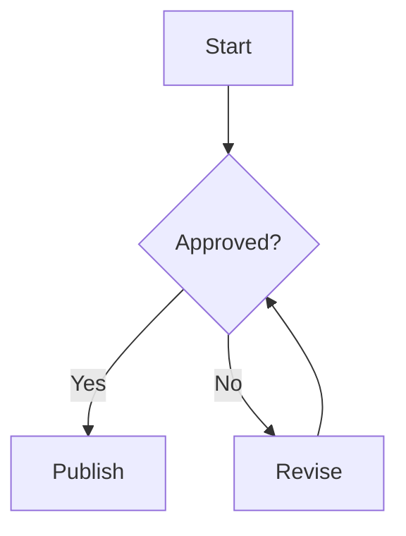
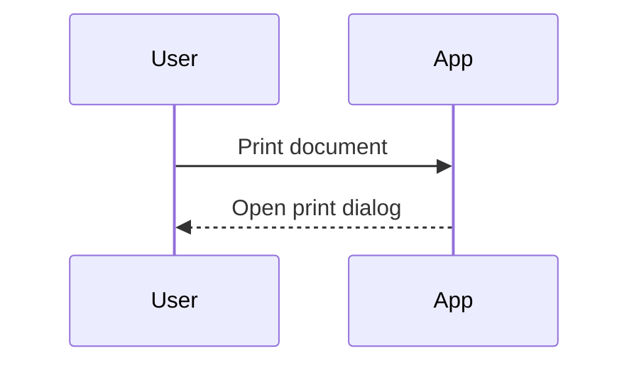
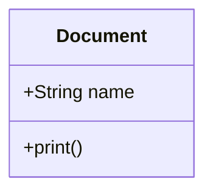
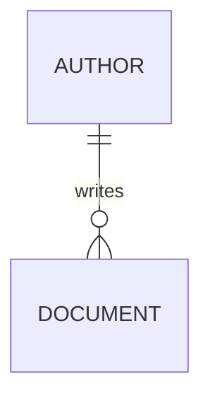

# MarkMind / DocIT syntax reference

Write these examples in the Markdown editor. The preview supports ordinary Markdown, GitHub Flavored Markdown (GFM), KaTeX mathematics, and the custom formats below. Special formats are preserved literally inside ordinary code blocks and inline code.

## Contents

- [Text, headings, and line breaks](#text-headings-and-line-breaks)
- [Links and images](#links-and-images)
- [Lists, quotes, tables, and rules](#lists-quotes-tables-and-rules)
- [Footnotes](#footnotes)
- [Code](#code)
- [Mathematics](#mathematics)
- [Custom image blocks](#custom-image-blocks)
- [Mermaid diagrams](#mermaid-diagrams)
- [JSON diagram blocks](#json-diagram-blocks)
- [Copied diagrams and SVG](#copied-diagrams-and-svg)
- [Columns](#columns)
- [HTML and rendered HTML blocks](#html-and-rendered-html-blocks)
- [Document settings, pagination, and exports](#document-settings-pagination-and-exports)

## Text, headings, and line breaks

```markdown
# Heading 1
## Heading 2
### Heading 3
#### Heading 4
##### Heading 5
###### Heading 6

**Bold** and __also bold__
*Italic* and _also italic_
***Bold and italic***
~~Strikethrough~~

A paragraph.

A separate paragraph.
```

Setext headings also work: a line of `===` below text makes a level-one heading; `---` below text makes a level-two heading.

Blank lines separate paragraphs. A single newline inside a paragraph creates a visible line break in this app. Standard Markdown hard breaks (two spaces at the end of a line, or a trailing backslash) and `<br>` also work.

Escape Markdown punctuation with a backslash, such as `\*literal asterisks\*` or `\# not a heading`. Use code spans when showing syntax literally. HTML entities such as `&amp;` and `&lt;` are supported.

## Links and images

```markdown
[Visit the project](https://example.com)
[Link with a title](https://example.com "Example website")
<https://example.com>
<person@example.com>
https://example.com

[Reference link][project]

[project]: https://example.com "Project homepage"


![Reference image][photo]

[photo]: https://example.com/photo.png
```

GFM turns ordinary web addresses and email addresses into links. Use browser-accessible HTTP(S) image URLs or relative URLs. Relative URLs resolve against the app's URL, so use an absolute URL or a file served by the app when sharing a document. The Markdown renderer strips `data:` image URLs in ordinary Markdown, raw HTML, and custom image blocks. Embedded raster data inside `chatgpt-svg` imports and HTML supplied through `html-render` use separate rendering paths. Standard images support alternative text and an optional title; use [custom image blocks](#custom-image-blocks) for preset sizes, alignment, and effects.

## Lists, quotes, tables, and rules

```markdown
- Unordered item
- Another item
  - Nested item

1. First ordered item
2. Second ordered item
   1. Nested ordered item

- [ ] Pending task
- [x] Completed task

> A blockquote.
>
> Another paragraph in the same quote.
>> A nested quote.

| Left aligned | Centered | Right aligned |
| :--- | :---: | ---: |
| **Bold cell** | Middle | 12 |
| Text | `code` | 34 |

---
```

Unordered markers `-`, `*`, and `+` are accepted. Ordered lists also accept `1)` markers. Indent nested content consistently. Task checkboxes indicate document content; they are not interactive editing controls. Escape a pipe inside a table cell as `\|`.

Horizontal rules can use `---`, `***`, or `___` on their own line. They are hidden by default; enable **Horizontal rules** in Document settings to show them. Rules do not force a new page.

## Footnotes

```markdown
The result follows from the reference.[^reference]

[^reference]: The source or explanatory note.

    An indented paragraph continues the same footnote.
```

Use `[^identifier]` for a reference and `[^identifier]:` for its definition. The preview renders numbered references and a footnote section at the end of the document. Indent continuation paragraphs by four spaces. The notes become rendered document content in PDF and Word export; Word export does not create native Word footnote objects.

## Code

Use backticks for inline code, for example `` `const value = 1` ``. If the content contains a backtick, surround it with a longer run of backticks. Newlines in inline code are treated as spaces.

````markdown
```typescript
interface User {
  name: string;
}
```

```
Plain code without a language.
```

~~~python
print("Tilde fences also work")
~~~
````

Four-space-indented blocks also render as code. Fences use at least three backticks or tildes; close with the same character and at least the opening length. Use longer outer fences when documenting shorter fences. A language name selects syntax highlighting, using the installed Prism language support; unknown languages are displayed as code.

**Code & AI settings** controls fonts, highlighting, line numbers, the window header, borders, and dark code backgrounds. The following fence languages have special rendering behavior instead of ordinary highlighting:

| Fence language | Content |
| --- | --- |
| `mermaid` | Mermaid source |
| `chatgpt-mermaid` | Alias for Mermaid source |
| `diagram` | Validated JSON diagram definition |
| `chatgpt-svg` | Base64-encoded UTF-8 SVG |
| `chatgpt-rad` | Built-in RAD model visual |
| `html-render` | Rendered HTML, optionally with an aspect ratio |

Use these names in lowercase. An ordinary `html` fence shows source code; it does not render the HTML.

## Mathematics

KaTeX renders math written with dollar delimiters or common LaTeX delimiters:

```markdown
Inline: $E = mc^2$ and \(a^2 + b^2 = c^2\).

$$
\frac{a+b}{c} = \sqrt{x}
$$

\[
\sum_{i=1}^{n} i = \frac{n(n+1)}{2}
\]
```

Put display delimiters on their own lines for predictable layout. A standalone `\[...\]` becomes display math; when embedded inside prose, it stays inline. `\(...\)` is inline math. Keep dollar-delimited inline formulas adjacent to their delimiters: `$x + y$`.

KaTeX supports fractions, roots, bounds, Greek letters, matrices, aligned equations, and its other supported TeX commands. For example:

```markdown
$$
\begin{aligned}
x + y &= 3 \\
x - y &= 1
\end{aligned}
$$

$$
\begin{bmatrix}
1 & 2 \\
3 & 4
\end{bmatrix}
$$
```

The app also recovers complete standalone copied TeX expressions beginning with these commands: `\boxed`, `\frac`, `\dfrac`, `\tfrac`, `\sqrt`, `\lim`, `\sum`, `\prod`, `\int`, `\iint`, `\iiint`, `\begin`, `\end`, `\left`, `\right`, `\displaystyle`, `\overline`, `\underline`, `\vec`, and `\hat`. Recovery is conservative: braces and environments must balance, fractions need both arguments, and bounded operators need an operand. Prefer explicit delimiters when authoring new content.

```markdown
\boxed{E = mc^2}

\frac{a}{b}
```

Copied expressions with doubled backslashes are normalized within recognized math contexts. Native `\\` row separators in matrices and aligned equations are preserved. Literal examples inside Markdown code are not converted. Ordinary prices such as `$5` remain text; write `\$5` when you want to make that intent explicit. This supports KaTeX expressions, not full LaTeX documents, packages, or arbitrary TeX macros.

## Custom image blocks

```text
[img - option1 - option2 - URL]
```

The opening keyword is lowercase `img`. Separate options with a hyphen surrounded by whitespace (` - `), and put the URL last. Options are case-insensitive and applied in order; later conflicting size/effect options can replace earlier values. Use one alignment option per image. Unknown options are ignored. A Markdown link can wrap the final URL:

```markdown
[img - full - rounded - shadow - https://example.com/hero.png]
[img - cover - 16:9 - https://example.com/banner.jpg]
[img - 300x300 - circle - center - https://example.com/avatar.png]
[img - half - right - [Photo](https://example.com/photo.png)]
```

Without options, the image uses full width, natural height, and centered placement. Images are limited to the available width. The custom syntax uses the alternative text `Image`; use ordinary Markdown images or raw `` when descriptive alternative text is needed.

| Size option | Result |
| --- | --- |
| `full` | Width 100% |
| `half` | Width 50% |
| `third` | Width 33.33% |
| `quarter` | Width 25% |
| `fit` | Width 100%, natural height, contain fit |
| `cover` | Width 100%, height 320px, cover fit (may crop) |
| `semi-cover` | Width 50%, height 200px, cover fit (may crop) |
| `800x600` | Requested width and height in pixels, written as `WIDTHxHEIGHT` using positive integers |
| `16:9` | CSS aspect ratio written as positive integers, such as `4:3` or `1:1`; resets height to auto |
| `480p` | Height 240px |
| `720p` | Height 350px |
| `1080p` | Height 450px |
| `4k` | Height 600px |

The resolution names select display heights; they do not resize or improve the source image. Use positive dimensions and ratios. Cropping depends on `object-fit`, the selected size, and the source proportions.

| Alignment option | Result |
| --- | --- |
| `center` | Centered block (default) |
| `left` | Float left with surrounding text wrapping |
| `right` | Float right with surrounding text wrapping |

| Effect option | Result |
| --- | --- |
| `rounded` | 12px corner radius |
| `circle` | 50% radius, square aspect ratio, cover fit |
| `shadow` | Drop shadow |
| `border` | 3px violet-tinted border |
| `grayscale` | Grayscale filter |

## Mermaid diagrams

Put Mermaid v11 source inside a `mermaid` fence. `chatgpt-mermaid` is an equivalent alias, used for some copied content.

````markdown







````

The installed Mermaid version also supports its other diagram grammars, including `stateDiagram-v2`, `pie`, `journey`, `timeline`, `gantt`, `gitGraph`, and `mindmap`. See [Mermaid's syntax documentation](https://mermaid.js.org/intro/syntax-reference.html) for the complete grammar of each diagram family. MarkMind does not define a separate grammar for them.

Use unique node IDs within each diagram, quote labels that contain punctuation, and keep each flowchart edge statement on its own line. Multiple diagram fences render independently. Diagrams use the document theme and fit their available width while preserving proportions; tall diagrams receive a larger height allowance, up to 720px. Very large diagrams are easier to read when divided into smaller diagrams.

Mermaid runs in strict security mode. Generated SVG is sanitized before display, so active content and external references can be removed. Invalid source produces a diagram error instead of a valid visual; fix the source before exporting.

## JSON diagram blocks

The `diagram` fence accepts JSON, with automatic layout and SVG output:

````markdown
```diagram
{
  "type": "flowchart",
  "title": "Document workflow",
  "nodes": [
    { "id": "start", "label": "Draft", "kind": "start" },
    { "id": "review", "label": "Review", "kind": "decision" },
    { "id": "done", "label": "Publish", "kind": "end" }
  ],
  "edges": [
    { "source": "start", "target": "review" },
    { "source": "review", "target": "done", "label": "Approved" }
  ]
}
```
````

| Field | Required | Accepted value |
| --- | --- | --- |
| `type` | Yes | `flowchart`, `network`, `architecture`, `database`, `uml`, or `mindmap` |
| `title` | No | String |
| `nodes` | Yes | Array of node objects |
| `edges` | Yes | Array of edge objects; `[]` is allowed |
| Node `id` | Yes | Nonempty string, unique in this diagram |
| Node `label` | Yes | Nonempty string |
| Node `kind` | No | One of the node kinds below |
| Edge `source` | Yes | ID of an existing node |
| Edge `target` | Yes | ID of an existing node |
| Edge `label` | No | String |

All node kinds:

```text
start end process decision database server client actor component
chip pin memory storage cloud
```

The same schema is used for every diagram type. Choose the type that matches the subject, and use node kinds to select shapes. For example, an `architecture` diagram can use `client`, `server`, and `storage`; a `database` diagram can use `database` nodes; a `uml` diagram can use `actor` and `component`. Node labels are text, not a second diagram language.

Use strict JSON: double quotes, no comments, and no trailing commas. Do not supply `x` or `y` coordinates; validation rejects them. Layout is automatic. Extra properties are not documented styling controls. Keep labels short and put long explanations in normal Markdown. A validation error lists invalid fields or missing references.

## Copied diagrams and SVG

Pasting HTML from ChatGPT into the editor preserves available Mermaid source, or imports the rendered SVG when source is unavailable. Multiple diagrams can coexist with surrounding Markdown. A plain-text copy that only contains diagram CSS and labels may require reconstruction and cannot preserve missing edges exactly. Paste source or a captured SVG for accurate diagrams.

The repository includes a [diagram copy userscript](../public/diagram-copy-helper.user.js) and a [bookmarklet](../public/diagram-copy-helper.bookmarklet.txt) for preserving live diagrams when ChatGPT's response copy omits SVG geometry. Their output contains `chatgpt-svg` blocks; the optional `<!-- markmind-diagram-capture:v1 diagrams=N -->` comment is capture metadata, not visible document content.

Install the `.user.js` file through a userscript manager, or copy the bookmarklet text into a bookmark's URL and run that bookmark in the ChatGPT conversation tab. Then use ChatGPT's **Copy response** button and paste into MarkMind. The helper's panel reports its status and preserved diagram count, and offers a report download and **Disable helper**. It needs the live diagrams in that ChatGPT tab; if capture fails, it keeps the original copy and reports the reason.

A `chatgpt-svg` fence contains **Base64 of the UTF-8 SVG text**, without a `data:` prefix. For example, this encodes `<svg viewBox="0 0 100 40"><rect width="100" height="40" fill="royalblue"/></svg>`:

````markdown
```chatgpt-svg
PHN2ZyB2aWV3Qm94PSIwIDAgMTAwIDQwIj48cmVjdCB3aWR0aD0iMTAwIiBoZWlnaHQ9IjQwIiBmaWxsPSJyb3lhbGJsdWUiLz48L3N2Zz4=
```
````

Imported SVG is sanitized: scripts, event handlers, active embeds, animation, and external references are removed. Embedded PNG/JPEG/GIF/WebP data images and internal SVG references can be retained. IDs and styles are scoped per diagram. Supply a positive `viewBox`, or numeric width and height from which one can be derived. Invalid Base64, invalid UTF-8, or missing SVG geometry produces an import error. Imported diagrams preserve their proportions and fit the available space.

Raw inline SVG is also accepted through HTML, and SVG IDs beginning `chatgpt-mermaid-` receive the copied-diagram wrapper and fitting behavior. Raw HTML is a different path from sanitized `chatgpt-svg` imports; use the encoded import format for captured diagrams.

The compatibility fence `chatgpt-rad` renders a **fixed RAD model** with Requirements Planning, User Design, Construction, Cutover, User Feedback, and Improvements. Its body is ignored; it is not a general-purpose diagram syntax. It is also generated when recovering recognized RAD copies. Use `mermaid` or `diagram` for custom models.

## Columns

```markdown
::: columns
### Left column

- First point
- Second point
|||
### Right column

Text, images, or diagrams can go here.
:::
```

Put `::: columns`, each `|||` separator, and the closing `:::` on their own lines. Each separator creates another equal-width column. Inner Markdown, including diagram fences, is supported. Columns have a gap and diagrams fit the narrower width. Keep each group compact enough to fit a page. Nested column directives are not supported by this simple format.

## HTML and rendered HTML blocks

Raw HTML can appear directly in Markdown:

```html
<u>Underlined text</u>
<span style="color:royalblue">Colored text</span>
<br>

```

The fence above is an example showing source; remove it to render the HTML. For block-level raw HTML containing Markdown, surround the inner Markdown with blank lines. HTML comments are accepted and hidden.

Use `html-render` when an entire HTML fragment should render as a custom visual block instead of code:

````markdown
```html-render
<div style="padding:24px;border-radius:12px;background:royalblue;color:white">
  A custom banner
</div>
```

```html-render:16:9
<div style="height:100%;display:flex;align-items:center;justify-content:center;background:#0f172a;color:white">
  A visual with a fixed aspect ratio
</div>
```
````

The optional ratio accepts `html-render:16:9`, `html-render:16x9`, or `html-render:16/9`, with positive integer values. The wrapper is full width; a ratio sets its aspect ratio and clips overflow. Without a ratio, height follows the content. Inline CSS is supported. The body is HTML, so Markdown inside it is not parsed. This renders a fragment, not a separate webpage or an isolated iframe.

Raw HTML and `html-render` are not passed through the diagram SVG sanitizer. Only use trusted HTML. Do not rely on scripts, interactive widgets, remote styles, or embedded video for static PDF/Word output; the print result depends on the browser's loaded content and supported styles.

## Document settings, pagination, and exports

**Document name** changes the browser tab title and the suggested PDF filename when **Print** opens the browser's print dialog. Leading and trailing whitespace is trimmed; an empty or whitespace-only name uses `DocIT`. The setting lasts for the current app session. The browser's Save as PDF dialog controls the final filename and permits editing it. This setting does not insert a heading or running header into the document. Word export currently downloads `document.docx`.

Use the separate **Running header** setting for text repeated at the top of pages. Themes, page margins, font sizes, page numbers, and code styling are UI settings rather than Markdown directives.

Content is automatically paginated into A4 preview pages. There is no custom manual page-break syntax; `---` is only a horizontal rule, and `<!-- pagebreak -->` is only a hidden comment. Browser CSS page-break styles are not a guaranteed command to the preview paginator. Diagrams and visual blocks are kept together when possible; oversized visuals may be scaled. Print waits for the latest preview and diagram layout before opening the dialog. Browser/printer paper settings can override the requested A4 portrait size.

PDF printing uses the rendered page appearance. Word export converts the rendered content and includes supported text formatting, lists, tables, images, and diagrams, but arbitrary HTML/CSS and columns need not retain the exact browser layout. Remote images that cannot be loaded for canvas conversion, including images blocked by cross-origin restrictions, can be omitted from Word export. Mathematics is exported as rendered images to preserve its appearance. Always review a document with custom HTML or complex layout in the target format.

YAML front matter, MDX/JSX components, executable code, and arbitrary `:::` directives have no dedicated support in this app. Use ordinary Markdown or one of the documented formats instead.
