# Chapter 1: Introduction

---

## 1.1 Background of the Study

The rapid growth of **Information Technology (IT)** has significantly changed the way organizations store, manage, and access information. Traditional manual systems are increasingly being replaced by **web-based applications**, **cloud services**, and **database-driven solutions** that improve efficiency, accuracy, and accessibility. As a result, practical knowledge of software development has become essential for students pursuing careers in the technology sector.

To bridge the gap between *theoretical learning* and *real-world implementation*, an internship was undertaken at **EventsBridge Technology Pvt. Ltd.**, a technology-oriented organization that focuses on innovation, digital transformation, and software-based solutions.

**Organization Name:** EventsBridge Technology Pvt. Ltd.
**Address:** Plot No. 689/6, Near Nilakantheswar Mandir, Nayapalli, Bhubaneswar – 751012, Odisha, India.

The internship was conducted from **08 May 2026 to 08 June 2026** and provided practical exposure through a project-based learning environment. During this period, a **Library Management System** was designed and developed as the assigned project. The objective of the project was to create a digital platform capable of managing books, users, rentals, administrative operations, and system analytics in an organized and secure manner.

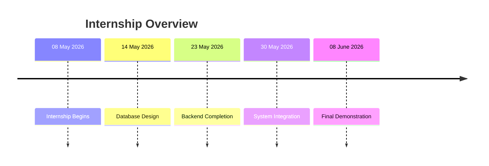

The project utilized modern web technologies including **HTML**, **CSS**, **JavaScript**, **Node.js**, **Express.js**, **MongoDB**, **Cloudinary**, and **Git**, allowing participants to experience the complete software development process from planning and design to testing and deployment.

---

## 1.2 Purpose of the Internship

The primary purpose of the internship was to provide practical experience in software development and expose students to industry-oriented development practices. The internship enabled the application of concepts learned in the classroom to a real-world project environment.

The internship focused on understanding various aspects of web application development, including:

* **System Analysis and Planning**
* **Database Design**
* **Frontend Development**
* **Backend Development**
* **API Integration**
* **Testing and Debugging**
* **Cloud Service Integration**
* **Project Documentation**

The experience also helped in developing problem-solving abilities, technical communication skills, teamwork, and professional work ethics required in the software industry.

---

## 1.3 Objectives of the Work

The major objectives of the internship were:

### Technical Objectives

* To design and develop a complete **Library Management System**.
* To create a structured database for storing users, books, rentals, and administrative data.
* To implement secure authentication and authorization mechanisms.
* To develop REST-based APIs for system operations.
* To integrate cloud storage services for hosting digital resources.

### Learning Objectives

* To understand the complete **Software Development Life Cycle (SDLC)**.
* To gain practical experience in modern web technologies.
* To improve debugging, testing, and deployment skills.
* To strengthen database design and API development knowledge.

### Professional Objectives

* To enhance teamwork and collaboration skills.
* To improve project planning and technical documentation abilities.
* To gain exposure to real-world software development practices.


The internship successfully provided valuable practical knowledge and industry exposure while contributing to the development of both technical competencies and professional skills.


# Chapter 2: Profile of the Organization

---

## 2.1 Details of the Organization

**EventsBridge Technology Pvt. Ltd.** is a technology-driven organization focused on developing innovative digital solutions and promoting technology-based services. The organization aims to bridge the gap between traditional service industries and modern technology by utilizing software platforms, cloud technologies, and digital transformation strategies.

EventsBridge is recognized as one of India's technology-oriented event vendor marketplace platforms with a vision to improve accessibility, transparency, and efficiency through digital innovation. The organization works towards simplifying complex processes by leveraging modern web technologies and data-driven systems.

During the internship period, the organization provided a project-oriented learning environment where participants were encouraged to apply theoretical knowledge to practical software development tasks. This approach helped in understanding real-world development workflows, project planning methodologies, and industry-standard practices.

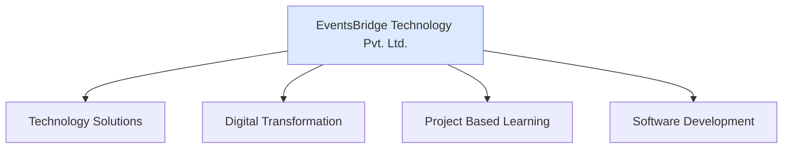

---

## 2.2 Location and General Information

The organization is located in **Nayapalli, Bhubaneswar**, one of the major commercial and educational hubs of Odisha.

**Address:**

> Plot No. 689/6
> Near Nilakantheswar Mandir
> Nayapalli
> Bhubaneswar – 751012
> Odisha, India

The company operates in a technology-focused environment where software development, digital platforms, and innovative solutions are utilized to address modern business requirements. The organization emphasizes practical learning, technical skill development, and exposure to current industry technologies.

The internship was conducted from **08 May 2026 to 08 June 2026**, during which participants worked on a real-world software project under professional guidance.

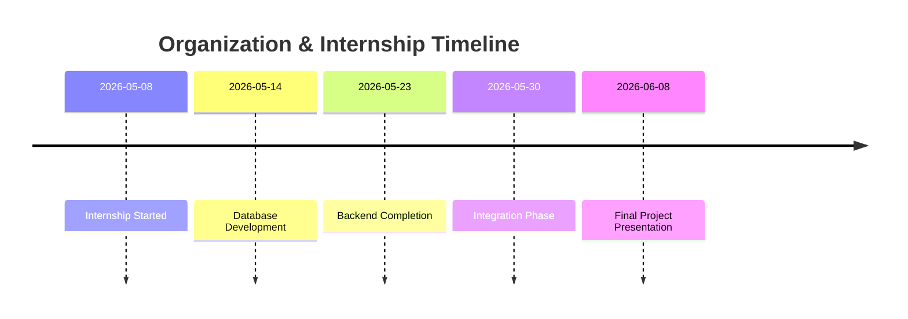

---

## 2.3 Nature of Activities and Services

EventsBridge primarily focuses on technology-enabled services and software solutions that improve operational efficiency and user experience. The organization encourages the use of modern technologies such as cloud computing, web development frameworks, databases, and digital platforms to solve practical problems.

The major activities associated with the internship project included:

* **Requirement Analysis and Planning**
* **Database Design and Management**
* **Frontend Development**
* **Backend API Development**
* **Cloud Storage Integration**
* **System Testing and Debugging**
* **Project Documentation**
* **Deployment and Demonstration**

As part of the internship, a **Library Management System** was developed. The system was designed to provide features such as:

| Module                 | Function                                |
| ---------------------- | --------------------------------------- |
| User Management        | Registration, Login, Account Management |
| Book Management        | Add, View, Search and Manage Books      |
| Rental Management      | Rent, Return and Fine Calculation       |
| Dashboard Analytics    | Statistics and System Monitoring        |
| Administration         | User and Book Administration            |
| Digital Access Control | Controlled Access to Book Files         |

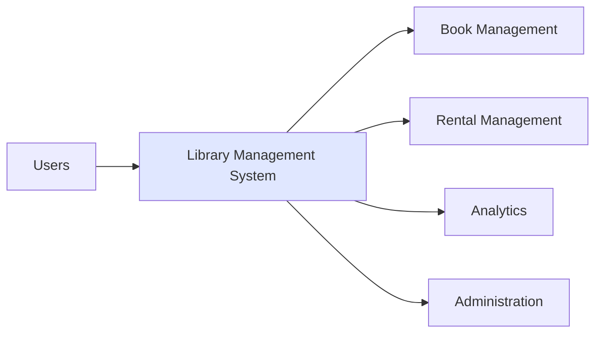

Through these activities, practical exposure was gained in software development, database management, API integration, cloud-based services, testing, and project deployment. The experience provided valuable insight into how modern software systems are planned, developed, and maintained in a professional environment.


# Chapter 3: Methodology / Work Plan

## 3.1 Approach Adopted

The development of the **Library Management System** followed a structured and practical approach. Before implementation began, the project requirements were analyzed to identify the major functionalities required in the system. These functionalities included user management, authentication, book management, rental processing, administrative controls, dashboard analytics, and digital book access.

The project was developed incrementally, where each module was planned, implemented, tested, and then integrated with the rest of the system. This approach helped in identifying issues at an early stage and ensured that each component functioned correctly before moving to the next phase.

Rather than developing the entire system at once, the work was divided into manageable stages such as planning, database design, backend development, frontend development, testing, and final deployment.

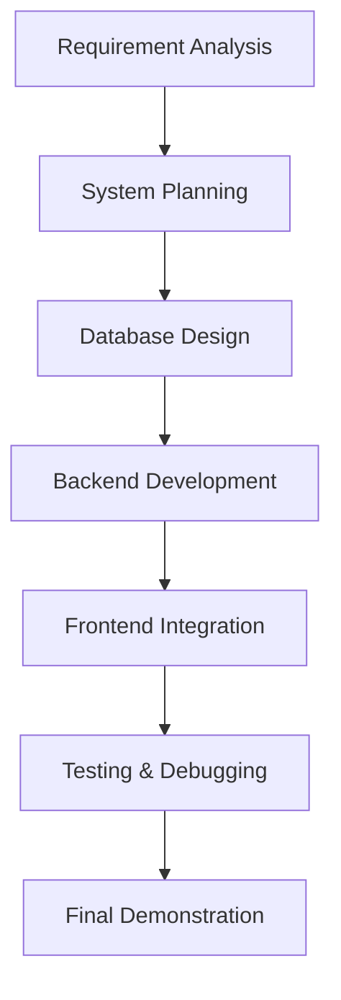

---

## 3.2 Tools and Techniques Used

Various tools and technologies were used throughout the development process to ensure efficient implementation and management of the project.

### Development Technologies

| Category        | Technology              |
| --------------- | ----------------------- |
| Frontend        | HTML5, CSS3, JavaScript |
| Backend         | Node.js, Express.js     |
| Database        | MongoDB with Mongoose   |
| Cloud Storage   | Cloudinary              |
| Version Control | Git and GitHub          |

### Techniques Adopted

The following methods were used during the internship:

* **Observation** of existing digital library platforms to understand common features and workflows.
* **Discussion and interaction** for requirement clarification and project planning.
* **Testing and debugging** to identify and resolve software issues.
* **Documentation** to simplify API integration and future maintenance.
* **Continuous review** of completed modules to ensure consistency and correctness.

---

## 3.3 Planning and Execution of Activities

The project execution started with the design of the database structure and identification of the required API routes. Once the overall architecture was finalized, development of the backend services began. MongoDB was selected as the database because of its flexibility and suitability for storing structured and semi-structured data.

After the backend APIs were developed, frontend pages were integrated with the server. Cloudinary was used to manage uploaded files such as book covers and user profile images.

Several security and validation mechanisms were also incorporated into the system. Authentication checks, session validation, rental restrictions, age verification, and protected book access controls were implemented to ensure secure operation of the application.

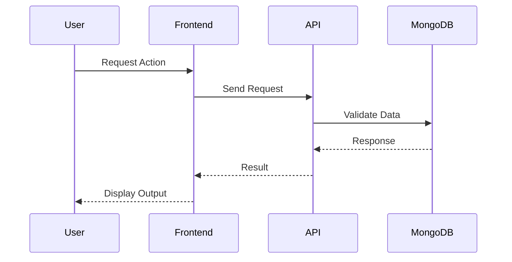

The final stage involved testing, debugging, and optimization of the application. Particular attention was given to authentication, file uploads, database operations, dashboard functionality, and user experience. After successful testing and verification, the system was prepared for demonstration and presentation.


# Chapter 4: Work Done / Activities Performed

---

## 4.1 Overview of Activities Performed

During the internship period, a web-based **Library Management System** was designed and developed with the objective of digitizing library operations and providing a centralized platform for managing books, users, rentals, and administrative activities.

The project was developed using modern web technologies including **HTML5**, **CSS3**, **JavaScript**, **Node.js**, **Express.js**, **MongoDB**, **Cloudinary**, and **Git/GitHub**. The work involved database design, API development, frontend implementation, cloud integration, testing, debugging, and final deployment preparation.

The development process was carried out in multiple stages beginning with planning and database design, followed by backend development, frontend implementation, system integration, testing, and project presentation.

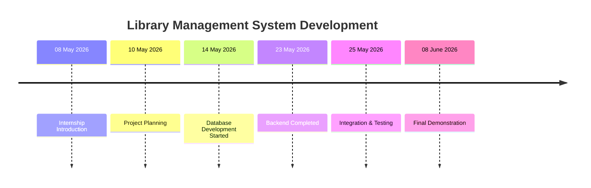

---

## 4.2 Requirement Analysis and Project Planning

The initial phase of the project focused on understanding the requirements of a digital library system. The major modules required for the project were identified and discussed before development began.

The planned functionalities included:

* User Registration and Login
* Book Management
* Rental and Return Management
* Dashboard Analytics
* Administrative Controls
* Search Functionality
* Digital Book Reader
* Payment Interface
* User Account Management

During this stage, the overall system architecture was planned and responsibilities for different modules were allocated. Multiple design concepts were reviewed before finalizing a common structure for both user-facing and administrative sections of the application.

---

## 4.3 Database Design and Backend Development

The backend development began with the creation of a MongoDB database and the design of a logical schema for managing application data.

The system was designed around five major collections:

* Users
* Books
* Rents
* Admin
* Data

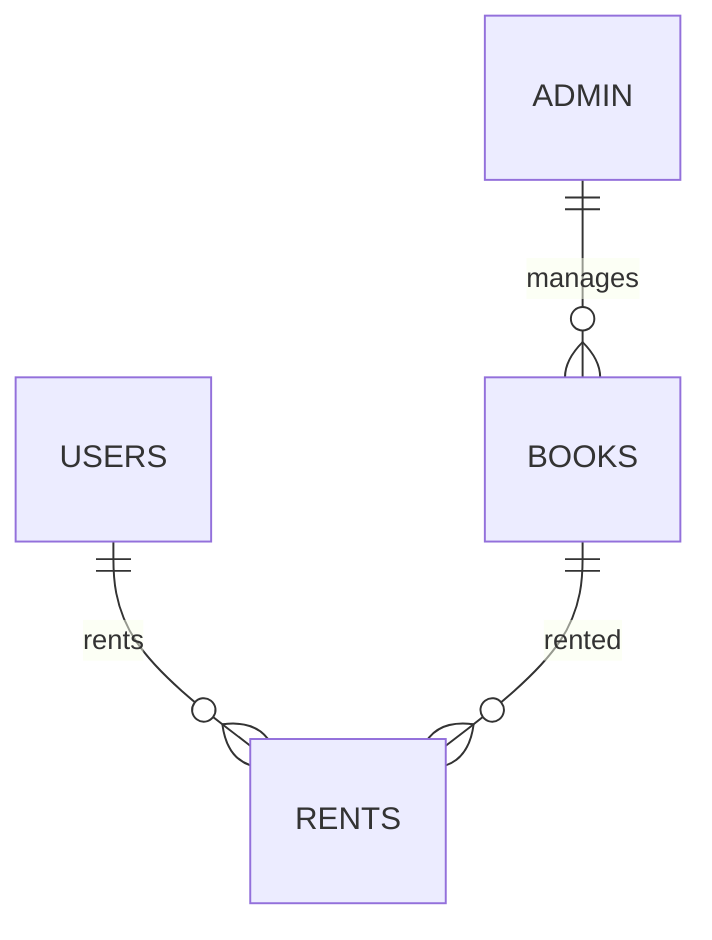

As development progressed, the database structure was refined several times to support additional features such as categories, descriptions, analytics tracking, content visibility controls, and improved data organization.

The backend was developed using **Node.js** and **Express.js**. Multiple REST APIs were implemented to handle authentication, book operations, rental management, dashboard statistics, administrative controls, and session validation.

Special attention was given to security and validation mechanisms including:

* Session verification
* User authentication
* Authorization checks
* Account suspension controls
* Rental restrictions
* Secure digital book access

---

## 4.4 Frontend Development

The frontend of the application was developed using **HTML**, **CSS**, and **JavaScript**. Separate interfaces were designed for users and administrators to improve usability and maintain clear separation between operational and management activities.

The major pages developed for the system included:

* Landing Page
* Login Page
* Registration Page
* User Dashboard
* Search Page
* My Books
* Book Management
* User Management
* Admin Panel
* Payment Page
* PDF Reader
* Account Page
* Coming Soon Page

Considerable effort was invested in improving mobile responsiveness, user experience, layout consistency, and navigation structure across the application.

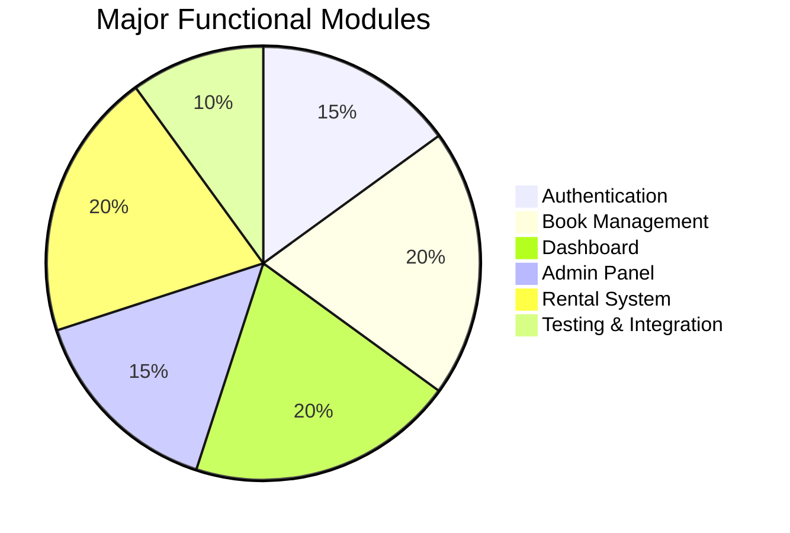

---

## 4.5 API Integration and Cloud Services

After the core frontend and backend modules were completed, integration activities were carried out to connect user interfaces with backend services.

The application utilized **Cloudinary** as a cloud-based storage solution for hosting uploaded resources such as:

* Book cover images
* User profile images
* Digital assets

Frontend pages were integrated with backend APIs using asynchronous requests, allowing real-time interaction between users and the database.

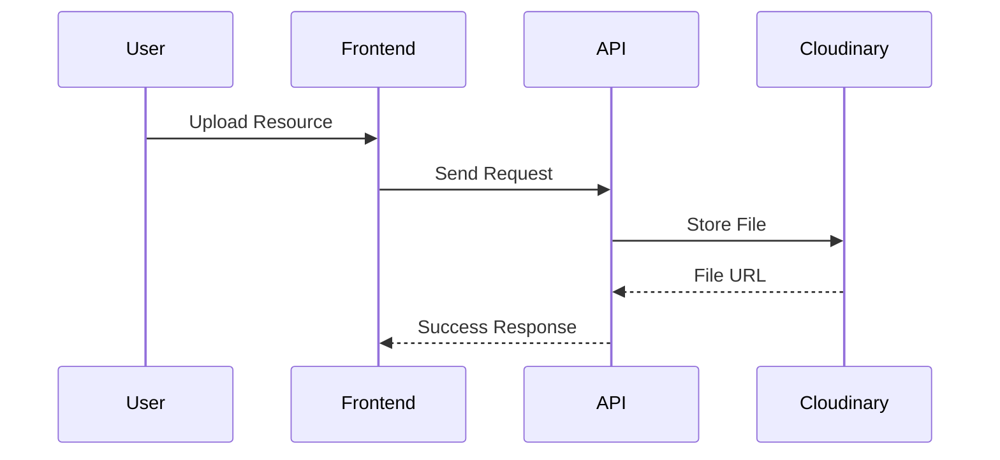

During this phase, challenges related to hosting environments and Cross-Origin Resource Sharing (CORS) were encountered and resolved to ensure proper communication between all system components.

---

## 4.6 Testing and Debugging

Testing was performed continuously throughout the development process to ensure reliability and correctness of the system.

The testing activities included:

* Login and Registration Testing
* Session Validation Testing
* Dashboard Testing
* Rental Workflow Testing
* Database Validation Testing
* Mobile Responsiveness Testing
* File Upload Testing
* API Endpoint Verification

Several issues related to authentication, database structure, dashboard integration, and file uploads were identified and corrected during this phase.

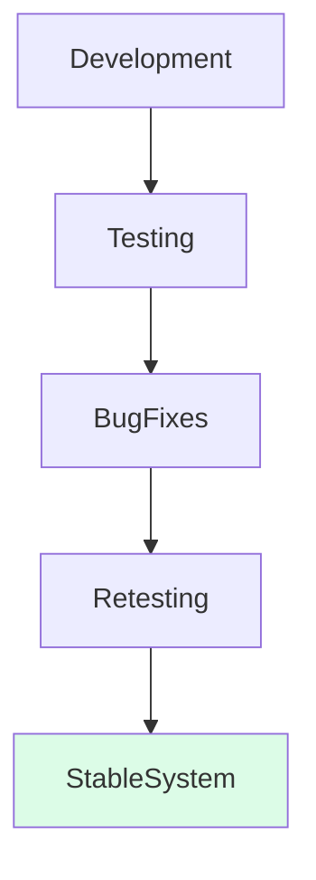

---

## 4.7 Seminar and Technical Learning Activities

On **23 May 2026**, a technical seminar session was conducted as part of the internship activities. The seminar covered various technology-related topics that provided additional exposure beyond the project itself.

Topics discussed during the seminar included:

* Docker and Containerization
* REST API Design
* Artificial Intelligence Concepts
* Machine Learning
* Cloud Computing
* Search Engine Technologies
* Website Hosting and Domains
* Software Testing Methodologies
* UI/UX Design Principles

The seminar enhanced understanding of modern software development practices and introduced several technologies that can be explored further in future projects.

---

## 4.8 Final Integration and Project Demonstration

The final stage of the internship focused on integrating completed modules, resolving remaining issues, and preparing the system for presentation.

Activities performed during this phase included:

* Final API integration
* Dashboard improvements
* User interface refinements
* Mobile responsiveness fixes
* Database verification
* End-to-end testing
* Documentation review
* Demonstration preparation

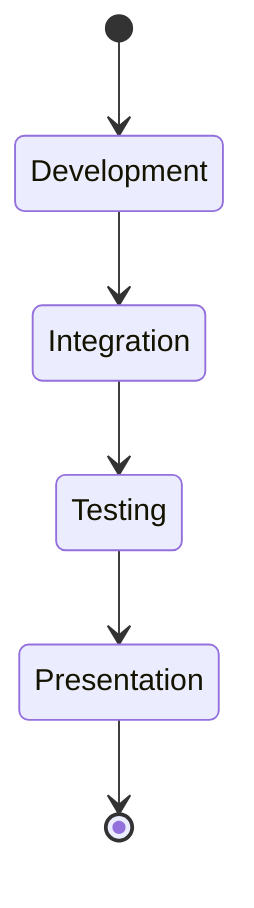

After successful testing and validation, the completed **Library Management System** was demonstrated on **08 June 2026**. The project successfully provided functionality for managing users, books, rentals, administration, analytics, and secure digital content access through a unified web platform.


# Chapter 5: Observations and Findings / Learning Outcomes

---

## 5.1 Key Observations During the Work

During the development of the **Library Management System**, several important observations were made regarding software development, system design, and project execution.

One of the major observations was that successful software development depends heavily on proper planning and database design. Although MongoDB is a schema-less database, a logical structure was still necessary to maintain consistency and prevent data duplication. During development, the database structure underwent multiple revisions to accommodate new requirements and improve data organization.

Another observation was the importance of API design. Well-structured APIs significantly simplified communication between the frontend and backend, making integration easier and reducing development complexity. It was also observed that documentation plays a crucial role in collaborative development because it allows different modules to be integrated more efficiently.

The project further demonstrated that even relatively simple web applications require multiple layers of security and validation. User authentication, session management, account restrictions, rental verification, and protected content access were all necessary to ensure secure operation of the system.

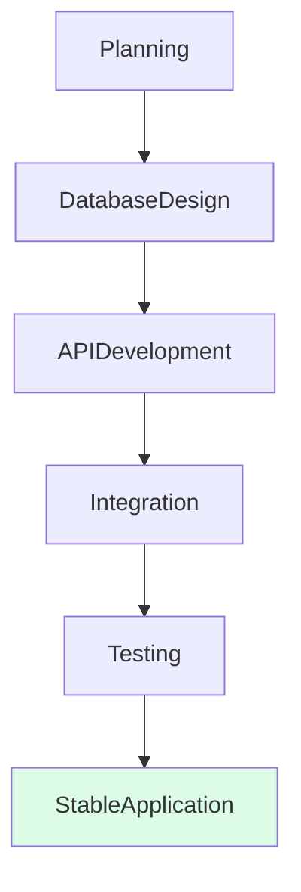

---

## 5.2 Findings and Analysis

The completed system successfully integrated multiple technologies into a single application. The use of MongoDB, Express.js, Cloudinary, and modern frontend technologies demonstrated how different software components can work together to create a functional web platform.

Several practical findings emerged during development:

* A well-designed database reduces future maintenance effort.
* API documentation improves development efficiency.
* Cloud-based file storage simplifies media management.
* Continuous testing helps identify issues before integration.
* Responsive design is essential because users access applications from different devices.
* Authentication and authorization mechanisms are fundamental components of modern web applications.

The project also highlighted the importance of scalability. Features that initially appeared simple often required additional planning when new requirements were introduced later in development.

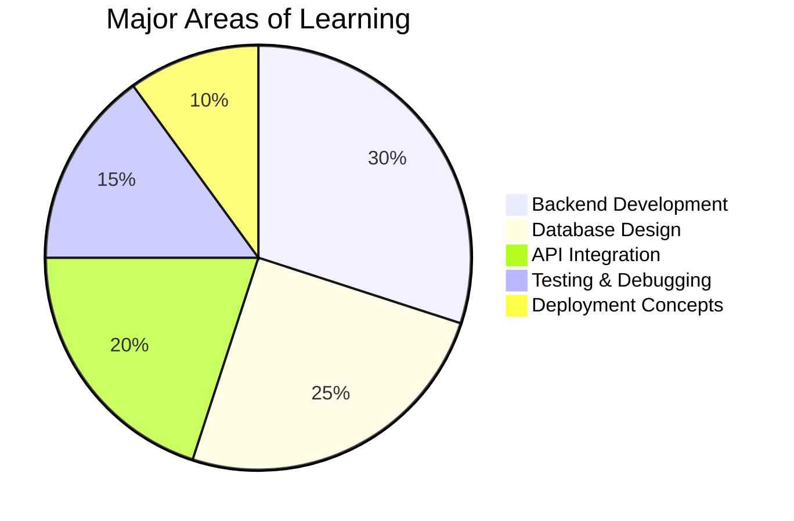

---

## 5.3 Learning Outcomes

The internship provided significant practical exposure to modern software development practices and greatly improved technical understanding.

### Technical Learning

The internship helped strengthen knowledge in:

* Database design using MongoDB.
* Backend development using Node.js and Express.js.
* REST API architecture and implementation.
* Cloud-based file hosting using Cloudinary.
* Authentication and session management techniques.
* Frontend-backend integration.
* Testing and debugging methodologies.

A particularly valuable learning experience was understanding how backend systems are designed and maintained. Creating APIs, handling validations, managing user sessions, and securing resources provided insight into real-world backend development practices.

The internship also introduced the practical importance of technologies such as **Redis**. While Redis was not implemented in the project, discussions during the internship helped develop an understanding of how caching systems can improve application performance by storing frequently accessed data and reducing unnecessary database operations.

### Professional Learning

Apart from technical knowledge, the internship also contributed to the development of professional skills such as:

* Problem-solving and analytical thinking.
* Technical communication.
* Project planning.
* Documentation practices.
* Collaborative development workflows.
* Version control using Git and GitHub.

### Personal Development

The project increased confidence in handling larger software systems and solving practical development challenges. Tasks such as restructuring databases, debugging APIs, resolving integration issues, and implementing security checks provided valuable real-world experience that cannot be fully gained through classroom learning alone.

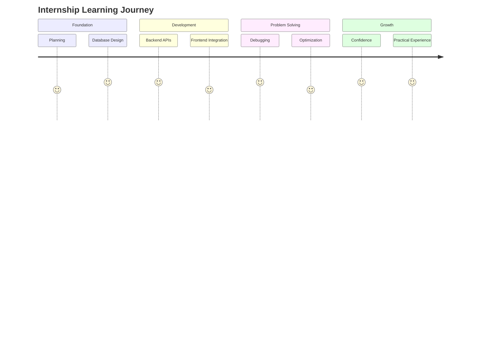

Overall, the internship successfully enhanced both technical and professional competencies while providing valuable exposure to real-world software development practices and industry workflows.


# Chapter 6: Challenges and Solutions

---

## 6.1 Problems Faced During the Work

The development of the **Library Management System** involved several technical and practical challenges. Since the project consisted of multiple interconnected modules such as user management, book management, rental processing, dashboard analytics, and cloud storage integration, various issues emerged during different stages of development.

One of the major challenges was **database design and modification**. As new requirements were identified during development, the original database structure required multiple revisions. Additional fields and relationships had to be introduced to support features such as categories, descriptions, analytics tracking, and future system expansion. Managing these modifications while maintaining data consistency required careful planning.

Another significant challenge was the implementation of the **file upload system**. Unlike normal API requests, file uploads involved communication between the frontend, backend server, and Cloudinary. Ensuring successful transfer of files while maintaining proper validation and response handling proved more complex than expected.


The project also encountered difficulties related to **Cross-Origin Resource Sharing (CORS)** when different services attempted to communicate with each other. Configuration issues initially prevented requests from being processed correctly between the frontend and backend environments.

Additionally, extensive debugging was required during the development of authentication systems, dashboard APIs, rental processing modules, and database operations. Some issues were caused by incomplete validations, while others were related to integration between different system components.

---

## 6.2 Steps Taken to Overcome the Challenges

To address database-related challenges, the schema design was continuously reviewed and refined whenever new requirements emerged. Redundant fields were removed, relationships were simplified, and the structure was reorganized to improve maintainability and scalability.

For the file upload system, extensive testing was performed to understand how data flowed between the frontend, backend, and Cloudinary. Validation mechanisms were improved and the upload process was repeatedly tested until stable functionality was achieved.

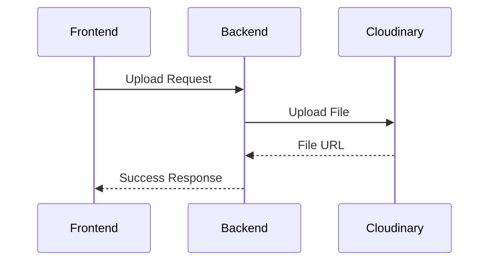

The CORS issues were resolved by analyzing request headers, server configurations, and hosting environment restrictions. Proper configuration settings were implemented to allow secure communication between services.

Continuous testing and debugging were used to resolve API-related issues. Authentication routes, dashboard endpoints, rental operations, and user management functions were repeatedly verified until expected results were achieved.

Several security checks were also introduced to improve system reliability:

* Authentication validation.
* Session verification.
* Rental restrictions.
* Account status checks.
* Protected book access controls.

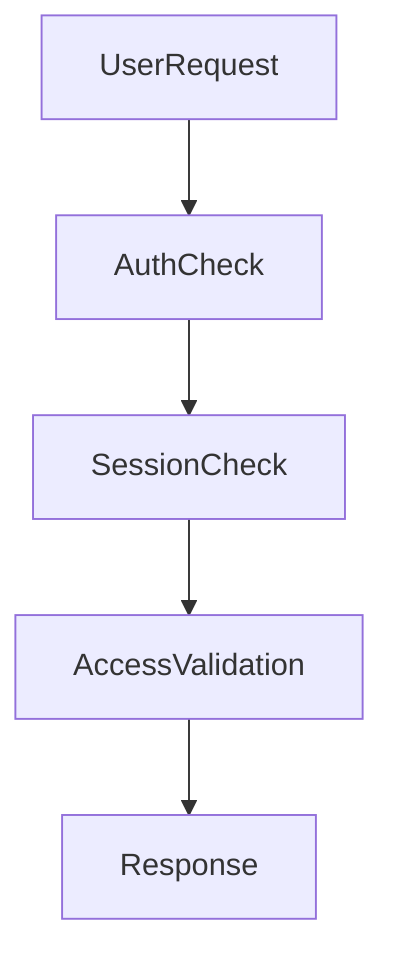

Another challenge involved understanding modern performance optimization concepts. During discussions and technical sessions, technologies such as **Redis** were introduced. Although Redis was not implemented in the project, learning about caching mechanisms provided insight into how frequently accessed data can be stored efficiently to improve application performance and reduce database load.

---

## 6.3 Outcome of the Problem-Solving Process

The process of overcoming these challenges significantly improved technical knowledge and problem-solving abilities. Working through database modifications, debugging complex API issues, resolving cloud integration problems, and handling deployment-related challenges provided valuable real-world development experience.

These challenges demonstrated that software development involves continuous learning, adaptation, and improvement. More importantly, they highlighted the importance of proper planning, testing, documentation, and systematic debugging when building large-scale applications.

As a result, the final Library Management System was able to operate successfully with secure authentication, cloud-based file storage, rental management functionality, dashboard analytics, and reliable frontend-backend integration.


# Chapter 7: Conclusion and Suggestions

---

## 7.1 Summary of the Experience

The internship at **EventsBridge Technology Pvt. Ltd.** provided valuable practical exposure to modern software development practices and industry-oriented project execution. During the internship period from **08 May 2026 to 08 June 2026**, a complete **Library Management System** was successfully designed, developed, integrated, tested, and demonstrated.

The project involved various stages of development including requirement analysis, system planning, database design, backend development, frontend implementation, cloud integration, testing, debugging, and final deployment preparation. Through these activities, practical knowledge was gained regarding the complete **Software Development Life Cycle (SDLC)** and the challenges involved in developing a real-world web application.

The internship provided an opportunity to apply theoretical concepts learned during academic studies to practical situations while working with modern technologies such as **HTML**, **CSS**, **JavaScript**, **Node.js**, **Express.js**, **MongoDB**, **Cloudinary**, and **Git**.

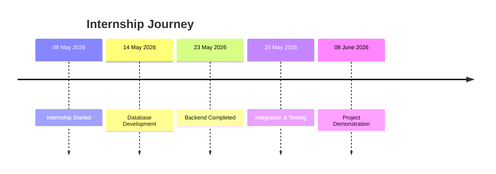

---

## 7.2 Suggestions for Improvement

Although the Library Management System successfully achieved its intended objectives, several improvements can be incorporated in future versions to enhance functionality, performance, and user experience.

Some possible future enhancements include:

* Implementation of a recommendation system for suggesting books based on user interests.
* Integration of email notification services for rentals, returns, and account activities.
* Migration to modern frontend frameworks such as **React** and **Vite** for improved maintainability and performance.
* Implementation of caching solutions such as **Redis** to optimize frequently accessed data and reduce database load.
* Addition of advanced analytics and reporting features.
* Integration of online payment gateways for real-world transactions.
* Enhanced security mechanisms and monitoring systems.

```mermaid
flowchart TD

CurrentSystem
--> EmailNotifications

CurrentSystem
--> RecommendationSystem

CurrentSystem
--> RedisCaching

CurrentSystem
--> AdvancedAnalytics

CurrentSystem
--> ModernFrontend
```

These enhancements would improve scalability, performance, and overall usability of the system.

---

## 7.3 Overall Learning and Benefits

The internship contributed significantly to both technical and professional development. It provided practical experience in solving real-world software development challenges and improved confidence in handling large-scale web applications.

Major technical skills developed during the internship include:

* Database design and management.
* Backend development using Node.js and Express.js.
* REST API development and integration.
* Authentication and authorization mechanisms.
* Cloud-based file storage integration.
* Testing and debugging techniques.
* Version control using Git and GitHub.

The internship also strengthened several professional skills such as:

* Problem-solving and analytical thinking.
* Technical documentation.
* Communication and collaboration.
* Project planning and execution.
* Time management and responsibility.

```mermaid
pie

title Overall Learning Distribution

"Backend Development" : 35

"Database Design" : 25

"API Integration" : 15

"Testing & Debugging" : 15

"Professional Skills" : 10
```

One of the most important outcomes of the internship was the increased confidence gained through practical implementation. Designing database structures, developing APIs, integrating cloud services, debugging issues, and successfully completing a full-stack web application provided valuable real-world experience that extends beyond classroom learning.

In conclusion, the internship was a highly beneficial learning experience that enhanced both technical knowledge and professional competence. It provided meaningful exposure to modern software development practices and served as an important step toward future career growth in the field of software engineering and web development.


# Final Section

## Annexure A – Geo-Tagged Photographs

The following photographs were captured during the internship period and serve as evidence of project development, implementation, testing, and final presentation activities.

### Photographs Included

* Screenshot of Landing Page
* Screenshot of Login Page
* Screenshot of User Dashboard
* Screenshot of Book Management Page
* Screenshot of Admin Panel
* Screenshot of Search Functionality
* Screenshot of PDF Reader / View Book Page
* Screenshot of MongoDB Database Collections
* Screenshot of API Testing Results
* Screenshot of GitHub Repository
* Screenshot of Final Project Demonstration

**[Insert Photographs Here]**

---

## Annexure B – Activity Log / Daily Diary

### Internship Duration

**Organization:** EventsBridge Technology Pvt. Ltd.

**Internship Period:** 08 May 2026 – 08 June 2026

**Working Hours:** 10:00 AM – 2:00 PM

**Duration:** 4 Hours Per Day

---

### Daily Activity Summary

#### 08.05.2026 (Friday)

* Internship orientation and introduction session conducted.
* Overview of organization structure, internship objectives, and expected outcomes discussed.
* Introduction to project-based workflow and development process.

---

#### 09.05.2026 (Saturday)

* Project allocation and discussion of development approach.
* Functional requirements of the Library Management System were discussed.
* Initial planning of modules and responsibilities completed.

---

#### 10.05.2026 (Sunday)

**Holiday / Weekly Off**

---

#### 11.05.2026 – 13.05.2026

* Requirement analysis performed.
* Research conducted on library management systems.
* Initial database structure planned.
* Core API architecture discussed.
* Development environment setup completed.
* Technology stack finalized.

```mermaid
timeline

title Project Initialization Phase

09 May : Project Allocation

11 May : Requirement Analysis

12 May : Database Planning

13 May : API Architecture Planning
```

---

#### 14.05.2026

**Backend Activities**

* MongoDB cluster created.
* Initial database collections established.
* Database architecture planning initiated.
* Project folder structure finalized.

**Frontend Activities**

* Initial user interface concepts prepared.
* Major application pages identified.
* Design approaches discussed and reviewed.
* Git and version-control workflow introduced.

---

#### 15.05.2026

**Backend Activities**

* Logical database schema designed.
* Authentication module planning completed.
* User account operations module created.

**Frontend Activities**

* Landing page, authentication pages, dashboard concepts, and administration layouts refined.
* Design improvements suggested and reviewed.
* Frontend structures prepared for API integration.

---

#### 16.05.2026

**Backend Activities**

* User-related API endpoints implemented.
* Login and registration APIs tested.
* Session handling logic verified.

**Frontend Activities**

* Dashboard UI completed.
* Authentication pages integrated with test APIs.
* Mobile responsiveness improvements initiated.

---

#### 17.05.2026 (Sunday)

**Holiday / Weekly Off**

---

#### 18.05.2026

**Backend Activities**

* User management APIs completed.
* Endpoint count significantly increased.
* API documentation preparation initiated.

**Frontend Activities**

* New UI structure adopted across modules.
* Interface consistency improvements performed.
* Administrative dashboard redesign continued.

---

#### 19.05.2026

**Backend Activities**

* Authentication APIs integrated.
* Extensive debugging of user endpoints performed.
* Session verification system tested.

**Frontend Activities**

* Authentication pages finalized.
* Dashboard and search components improved.
* Book management pages refined.

---

#### 20.05.2026

**Backend Activities**

* Additional API routes implemented.
* Rent tracking functionality improved.
* API documentation shared for integration.

**Frontend Activities**

* Landing page reviewed.
* User library pages updated.
* Additional interface refinements completed.

---

#### 21.05.2026

**Backend Activities**

* New endpoints developed.
* Backend system approached completion stage.
* API verification performed.

**Frontend Activities**

* Dashboard module pushed for review.
* User management interface development continued.
* Book management modules completed.

---

#### 22.05.2026

**Backend Activities**

* Rental API debugging completed.
* API review and optimization performed.

**Frontend Activities**

* Dashboard responsiveness improved.
* Payment page development progressed.
* Administrative layouts optimized.

---

#### 23.05.2026

**Backend Activities**

* Backend development completed.
* Public API testing completed.
* Integration support provided.

**Frontend Activities**

* Dashboard module reviewed.
* Payment module reviewed.
* Administrative interface enhancements continued.

### Seminar Activities

Technical seminar conducted covering:

* Docker
* REST APIs
* Artificial Intelligence
* Machine Learning
* Android Development
* Search Engines
* Website Hosting
* Cloud Computing
* Software Testing
* UI/UX Design

```mermaid
pie

title Seminar Topics

"Software Development" : 35

"Cloud Technologies" : 20

"AI & ML" : 20

"Testing" : 10

"UI/UX" : 15
```

---

#### 24.05.2026 (Sunday)

**Holiday / Weekly Off**

---

#### 25.05.2026

**Backend Activities**

* Module integration initiated.
* CORS-related deployment issue identified.
* Hosting environment testing performed.

**Frontend Activities**

* Book management pages merged.
* Dashboard redesign improvements reviewed.
* PDF reader development started.

---

#### 26.05.2026

**Backend Activities**

* Backend setup troubleshooting performed.
* Deployment issues investigated.

**Frontend Activities**

* Mobile responsiveness improvements implemented.
* Administrative layouts refined.
* View Book interface reviewed.

---

#### 27.05.2026

**Backend Activities**

* Additional APIs developed.
* Endpoint optimization continued.

**Frontend Activities**

* Dashboard integration progressed.
* UI alignment issues corrected.
* Mobile optimization continued.

---

#### 28.05.2026

**Backend Activities**

* Dashboard APIs developed.
* Authentication testing repeated.

**Frontend Activities**

* Dashboard improvements implemented.
* Coming Soon page completed.
* Account page planning initiated.

---

#### 29.05.2026

**Backend Activities**

* API integration work continued.
* Final endpoint verification performed.

**Frontend Activities**

* User dashboard refinements completed.
* Interface testing performed.
* View Book page improvements continued.

---

#### 30.05.2026

**Backend Activities**

* Dashboard APIs finalized.
* Final debugging completed.

**Frontend Activities**

* Dashboard fully integrated.
* Search functionality improved.
* Mobile responsiveness completed.
* User experience enhancements implemented.

---

#### 31.05.2026 (Sunday)

**Holiday / Weekly Off**

---

### 01.06.2026 – 07.06.2026

**Testing, Validation and Optimization Phase**

During the final week, the primary focus shifted from development to quality assurance and project stabilization.

Activities included:

* End-to-end testing.
* Authentication testing.
* Dashboard verification.
* Rental workflow testing.
* Database validation.
* API verification.
* Mobile responsiveness testing.
* Bug fixing and optimization.
* Documentation review.
* Presentation preparation.
---

#### 07.06.2026 (Sunday)

**Holiday / Weekly Off**

---

#### 08.06.2026

### Final Demonstration and Internship Completion

* Complete Library Management System demonstrated.
* System architecture explained.
* Database design presented.
* API structure explained.
* Frontend modules showcased.
* Testing results discussed.
* Project documentation submitted.
* Internship activities concluded successfully.

```mermaid
stateDiagram-v2

[*] --> Planning

Planning --> Development

Development --> Integration

Integration --> Testing

Testing --> Demonstration

Demonstration --> InternshipCompleted

InternshipCompleted --> [*]
```

---

## Annexure C – Supporting Documents

The following supporting documents are attached with the report:

* Project Screenshots
* Database Screenshots
* API Documentation
* GitHub Repository Screenshots
* Testing Records
* Seminar Participation Evidence
* Attendance Records
* Final Project Presentation Material

---

## Bibliography / References

1. MongoDB Documentation – Database Design and Operations.
2. Express.js Documentation – Backend API Development.
3. Node.js Documentation – Server-side Development.
4. Cloudinary Documentation – Cloud Storage Integration.
5. MDN Web Docs – HTML, CSS, and JavaScript Reference.
6. Git Documentation – Version Control and Collaboration.
7. Internship Notes, Project Reports, and Technical Documentation prepared during the internship period.
