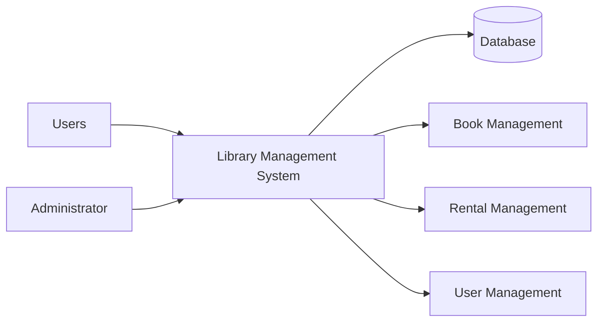
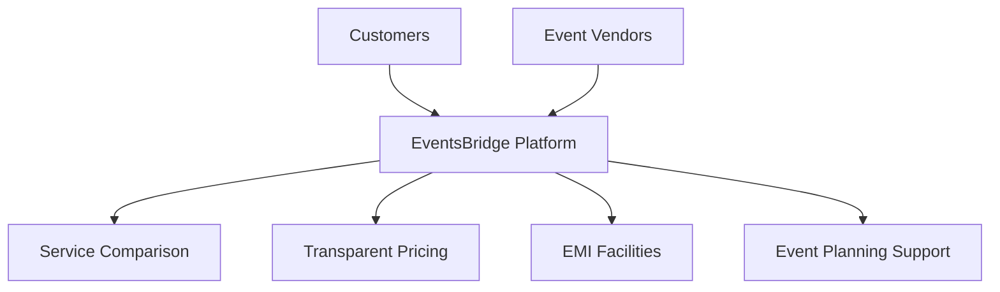
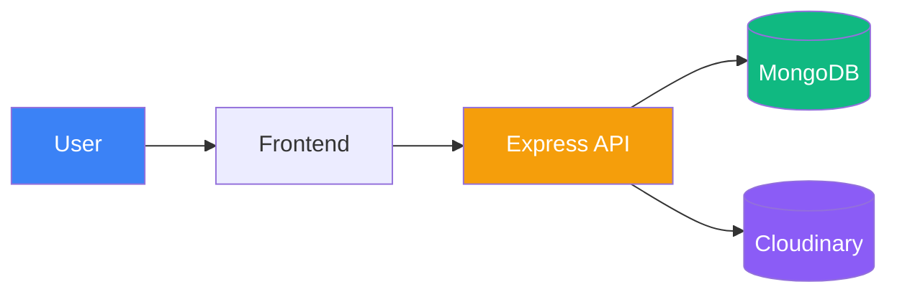

# Chapter 1: Introduction

## 1.1 Background of the Study / Activity

Technology has transformed the way organizations manage information and provide services. Many traditional systems that once relied on manual record keeping are now being replaced by digital solutions to improve efficiency, accuracy, and accessibility. Libraries are one such area where technology plays an important role in managing books, users, and transaction records.

As part of my internship in web development, I worked on the development of a **Library Management System**, a web-based application designed to automate library operations. The system was developed to manage user accounts, book records, rental information, and administrative activities through a centralized platform.

My primary involvement was in backend development, where I worked on database planning, API development, testing, debugging, and integration. The project provided practical exposure to software development processes and helped me understand how different technologies work together to create a complete web application.

The internship offered an opportunity to apply theoretical knowledge gained during academic studies in a practical environment while developing technical and professional skills.

### Project Overview

---

## 1.2 Purpose of the Internship

The internship was conducted to provide practical experience in software and web application development. It served as a bridge between academic learning and real-world implementation by allowing students to participate in an actual software project.

The internship aimed to improve technical knowledge related to databases, APIs, application development, testing, debugging, and deployment. It also provided exposure to industry practices and development workflows commonly followed in software projects.

Another important purpose was to develop problem-solving abilities and professional skills such as planning, communication, responsibility, and time management. Working on a project from the planning stage to final implementation helped in understanding the complete software development lifecycle.

---

## 1.3 Objectives of the Work

The objectives of the internship were:

* To gain practical experience in web development.
* To understand software development processes.
* To contribute to the development of a Library Management System.
* To learn database planning and API development.
* To improve testing and debugging skills.
* To gain experience in deployment and integration.
* To enhance problem-solving and analytical abilities.
* To apply academic knowledge in a real-world environment.

The successful completion of these objectives contributed significantly to my technical learning and professional growth.

---

# Chapter 2: Profile of the Organization

## 2.1 About EventsBridge

**EventsBridge** is India's first technology-driven Event Vendor Marketplace focused on empowering Tier 2 and Tier 3 cities. The organization aims to transform the event services industry into a digital, transparent, and financially inclusive ecosystem.

The platform helps customers discover trusted event vendors, compare services, evaluate pricing options, and access flexible EMI-based payment solutions. Through the use of technology and digital innovation, EventsBridge simplifies event planning and improves accessibility to professional event services.

At the same time, the platform provides vendors with opportunities to expand their reach, improve visibility, and connect with potential customers across different regions.

### EventsBridge Ecosystem

---

## 2.2 Location and General Information

**Organization Name:** EventsBridge Technology Pvt. Ltd.

**Address:** Plot No. 689/6, Near Nilakantheswar Mandir, Nayapalli, Bhubaneswar – 751012, Odisha, India.

EventsBridge operates as a technology-oriented organization that utilizes digital platforms and modern software solutions to improve service delivery in the event management industry. The organization focuses on innovation, digital transformation, and customer convenience through technology-driven solutions.

The internship was conducted over a one-month period from **08 May 2026 to 08 June 2026**. During this period, practical exposure was provided through project-based learning, allowing participants to work on software development activities and gain hands-on technical experience.

---

## 2.3 Nature of Activities and Services

EventsBridge provides a digital marketplace that connects customers with event service providers through a centralized platform. Its major services include:

* Vendor discovery and management.
* Service comparison and pricing transparency.
* Event planning support.
* EMI-based payment solutions.
* Digital platform management.
* Technology-driven customer services.
* Vendor growth and visibility support.

During the internship period, exposure to this technology-focused environment helped in understanding how modern software applications are designed, developed, tested, and deployed to solve practical business problems.

The experience provided valuable insight into real-world software development practices and contributed significantly to the successful development of the Library Management System project.

# Chapter 3: Methodology / Work Plan

## 3.1 Approach Adopted

The development of the Library Management System followed a structured and backend-first approach. Before implementation began, the project requirements were carefully analyzed to identify the major functionalities required within the system. Since the application needed to manage users, books, rentals, purchases, and administrative activities, proper planning was necessary to ensure efficient development and maintenance.

The project was divided into multiple stages including requirement analysis, database planning, API development, frontend integration, testing, and deployment. The backend infrastructure was developed first because it served as the foundation for all application functionalities. Once the database structure and APIs were completed, frontend pages were connected with backend services and tested.

A modular development strategy was followed throughout the project. Different functionalities such as user management, book management, rental management, and dashboard operations were developed independently and later integrated into the final application. This approach simplified debugging and allowed features to be tested individually before deployment.

### Development Methodology

---

## 3.2 Tools and Technologies Used

Several modern technologies and cloud services were used during development:

* **MongoDB** for database management.
* **Node.js** as the server-side runtime environment.
* **Express.js** for API and route development.
* **Cloudinary** for hosting user avatars and book-related media files.
* **Git** for version control and project management.
* **HTML, CSS, and JavaScript** for frontend development.
* **Cloud-based hosting services** for deployment and testing.

MongoDB was selected because of its flexibility and ability to handle document-based data efficiently. Although MongoDB is schema-flexible, logical schemas were designed before implementation to maintain consistency across records.

Cloudinary was used to store media assets such as profile images and book covers, reducing storage requirements on the server while improving accessibility.

---

## 3.3 System Architecture

The application follows a client-server architecture. Users interact with the frontend interface, which communicates with backend APIs. The backend processes requests, interacts with the database, and retrieves media files from Cloudinary whenever required.

### System Architecture Diagram

---

## 3.4 Planning and Execution

The project development process began with database planning and route design. After defining the required collections and application workflow, APIs were developed for user authentication, book management, rental operations, and dashboard functionalities.

Each endpoint was tested individually before integration with frontend pages. Following successful testing, frontend components were connected to backend services. Additional effort was dedicated to debugging, deployment, and resolving communication issues between frontend and backend services hosted on separate platforms.

The final phase involved system-wide testing, optimization, and verification of all major functionalities before project demonstration. This methodology ensured that the application remained stable, organized, and maintainable throughout development.
