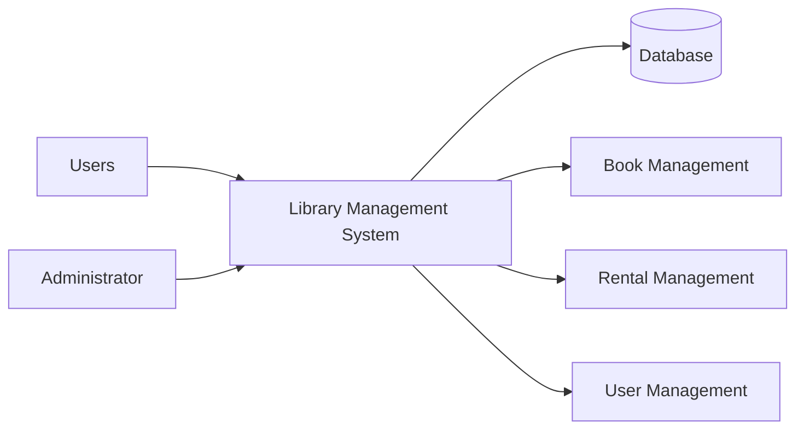
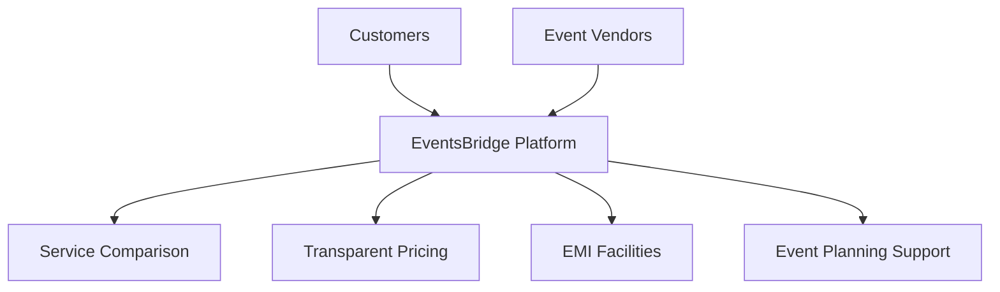
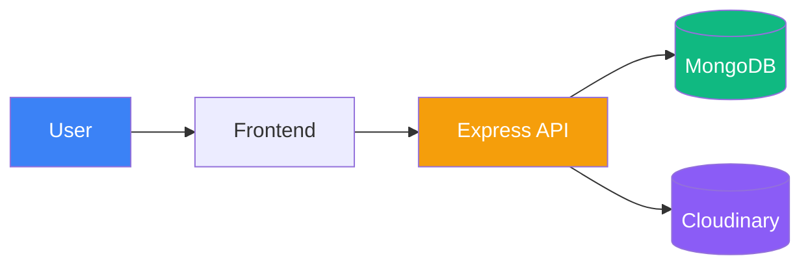
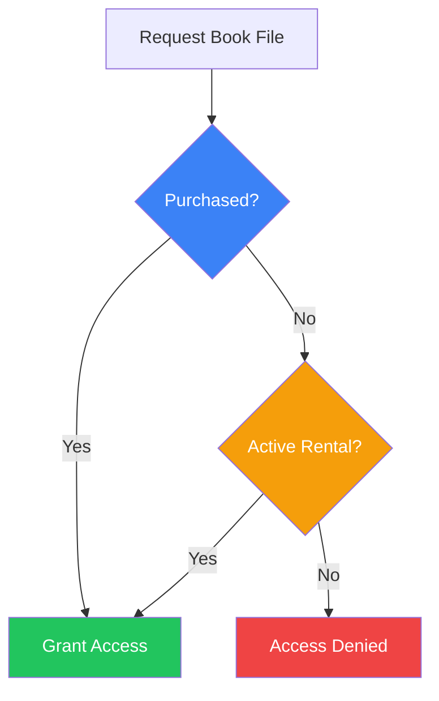
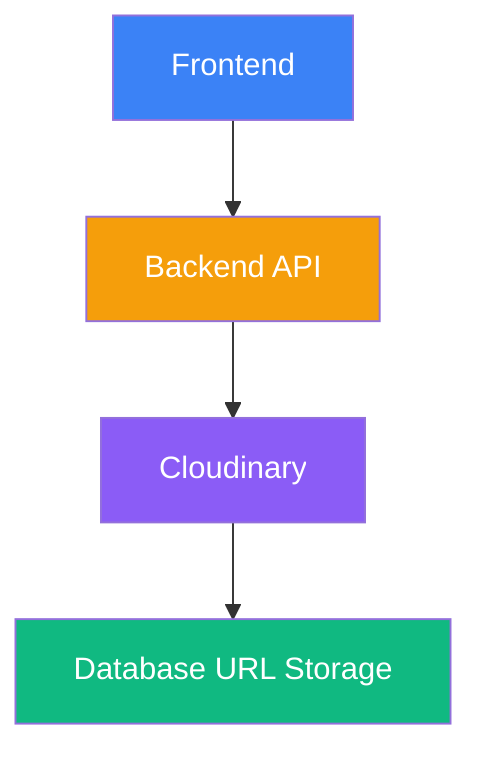
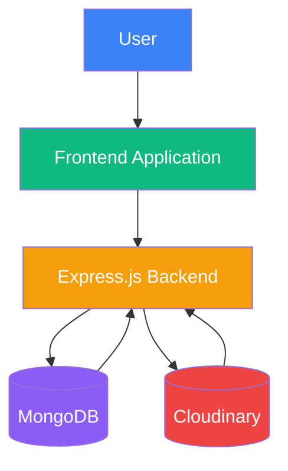

# Chapter 1: Introduction

## 1.1 Background of the Study / Activity

Technology has transformed the way organizations manage information and provide services. Many traditional systems that once relied on manual record keeping are now being replaced by digital solutions to improve efficiency, accuracy, and accessibility. Libraries are one such area where technology plays an important role in managing books, users, and transaction records.

As part of my internship in web development, I worked on the development of a **Library Management System**, a web-based application designed to automate library operations. The system was developed to manage user accounts, book records, rental information, and administrative activities through a centralized platform.

My primary involvement was in backend development, where I worked on database planning, API development, testing, debugging, and integration. The project provided practical exposure to software development processes and helped me understand how different technologies work together to create a complete web application.

The internship offered an opportunity to apply theoretical knowledge gained during academic studies in a practical environment while developing technical and professional skills.

### Project Overview

---

## 1.2 Purpose of the Internship

The internship was conducted to provide practical experience in software and web application development. It served as a bridge between academic learning and real-world implementation by allowing students to participate in an actual software project.

The internship aimed to improve technical knowledge related to databases, APIs, application development, testing, debugging, and deployment. It also provided exposure to industry practices and development workflows commonly followed in software projects.

Another important purpose was to develop problem-solving abilities and professional skills such as planning, communication, responsibility, and time management. Working on a project from the planning stage to final implementation helped in understanding the complete software development lifecycle.

---

## 1.3 Objectives of the Work

The objectives of the internship were:

* To gain practical experience in web development.
* To understand software development processes.
* To contribute to the development of a Library Management System.
* To learn database planning and API development.
* To improve testing and debugging skills.
* To gain experience in deployment and integration.
* To enhance problem-solving and analytical abilities.
* To apply academic knowledge in a real-world environment.

The successful completion of these objectives contributed significantly to my technical learning and professional growth.

---

# Chapter 2: Profile of the Organization

## 2.1 About EventsBridge

**EventsBridge** is India's first technology-driven Event Vendor Marketplace focused on empowering Tier 2 and Tier 3 cities. The organization aims to transform the event services industry into a digital, transparent, and financially inclusive ecosystem.

The platform helps customers discover trusted event vendors, compare services, evaluate pricing options, and access flexible EMI-based payment solutions. Through the use of technology and digital innovation, EventsBridge simplifies event planning and improves accessibility to professional event services.

At the same time, the platform provides vendors with opportunities to expand their reach, improve visibility, and connect with potential customers across different regions.

### EventsBridge Ecosystem

---

## 2.2 Location and General Information

**Organization Name:** EventsBridge Technology Pvt. Ltd.

**Address:** Plot No. 689/6, Near Nilakantheswar Mandir, Nayapalli, Bhubaneswar – 751012, Odisha, India.

EventsBridge operates as a technology-oriented organization that utilizes digital platforms and modern software solutions to improve service delivery in the event management industry. The organization focuses on innovation, digital transformation, and customer convenience through technology-driven solutions.

The internship was conducted over a one-month period from **08 May 2026 to 08 June 2026**. During this period, practical exposure was provided through project-based learning, allowing participants to work on software development activities and gain hands-on technical experience.

---

## 2.3 Nature of Activities and Services

EventsBridge provides a digital marketplace that connects customers with event service providers through a centralized platform. Its major services include:

* Vendor discovery and management.
* Service comparison and pricing transparency.
* Event planning support.
* EMI-based payment solutions.
* Digital platform management.
* Technology-driven customer services.
* Vendor growth and visibility support.

During the internship period, exposure to this technology-focused environment helped in understanding how modern software applications are designed, developed, tested, and deployed to solve practical business problems.

The experience provided valuable insight into real-world software development practices and contributed significantly to the successful development of the Library Management System project.

# Chapter 3: Methodology / Work Plan

## 3.1 Approach Adopted

The development of the Library Management System followed a structured and backend-first approach. Before implementation began, the project requirements were carefully analyzed to identify the major functionalities required within the system. Since the application needed to manage users, books, rentals, purchases, and administrative activities, proper planning was necessary to ensure efficient development and maintenance.

The project was divided into multiple stages including requirement analysis, database planning, API development, frontend integration, testing, and deployment. The backend infrastructure was developed first because it served as the foundation for all application functionalities. Once the database structure and APIs were completed, frontend pages were connected with backend services and tested.

A modular development strategy was followed throughout the project. Different functionalities such as user management, book management, rental management, and dashboard operations were developed independently and later integrated into the final application. This approach simplified debugging and allowed features to be tested individually before deployment.

### Development Methodology

---

## 3.2 Tools and Technologies Used

Several modern technologies and cloud services were used during development:

* **MongoDB** for database management.
* **Node.js** as the server-side runtime environment.
* **Express.js** for API and route development.
* **Cloudinary** for hosting user avatars and book-related media files.
* **Git** for version control and project management.
* **HTML, CSS, and JavaScript** for frontend development.
* **Cloud-based hosting services** for deployment and testing.

MongoDB was selected because of its flexibility and ability to handle document-based data efficiently. Although MongoDB is schema-flexible, logical schemas were designed before implementation to maintain consistency across records.

Cloudinary was used to store media assets such as profile images and book covers, reducing storage requirements on the server while improving accessibility.

---

## 3.3 System Architecture

The application follows a client-server architecture. Users interact with the frontend interface, which communicates with backend APIs. The backend processes requests, interacts with the database, and retrieves media files from Cloudinary whenever required.

### System Architecture Diagram

---

## 3.4 Planning and Execution

The project development process began with database planning and route design. After defining the required collections and application workflow, APIs were developed for user authentication, book management, rental operations, and dashboard functionalities.

Each endpoint was tested individually before integration with frontend pages. Following successful testing, frontend components were connected to backend services. Additional effort was dedicated to debugging, deployment, and resolving communication issues between frontend and backend services hosted on separate platforms.

The final phase involved system-wide testing, optimization, and verification of all major functionalities before project demonstration. This methodology ensured that the application remained stable, organized, and maintainable throughout development.

# Chapter 4: Description of Work Undertaken

## 4.1 Requirement Analysis and Project Planning

The development of the Library Management System began with understanding the project requirements and identifying the major functionalities that would be required within the application. The objective was to create a centralized platform capable of managing users, books, rentals, purchases, and administrative operations efficiently.

During the planning stage, special attention was given to data organization, system scalability, and ease of maintenance. The required modules were identified and grouped into logical sections including user management, book management, rental management, dashboard analytics, and administration.

Before implementation began, the complete workflow of the system was analyzed to determine how users would interact with the platform and how information would move between different modules. This planning phase helped establish a clear roadmap for development and reduced future design modifications.

---

## 4.2 Database Design and Implementation

One of my primary responsibilities was designing the database structure for the application. Since the project required managing different categories of information, MongoDB was selected as the database solution due to its flexibility and support for document-based data storage.

Although MongoDB is schema-flexible, a logical schema was designed before implementation to maintain consistency and ensure efficient data management.

The database was organized into five primary collections:

### User Collection

The User Collection stores information related to registered users including account credentials, personal information, authentication tokens, and profile details.

Key information stored includes:

* User ID
* Full Name
* Email Address
* Password
* Date of Birth
* Gender
* Avatar URL
* Login Token
* Token Expiry Date

### Book Collection

The Book Collection stores information about books available within the library.

Important fields include:

* Book ID
* Book Name
* Description
* Book Cover URL
* Book File URL
* Rent Price
* Buy Price
* Total Views
* Total Sales
* Total Rentals

### Rent Collection

The Rent Collection manages rental transactions and tracks book usage.

Stored information includes:

* Rental Serial Number
* Book ID
* User ID
* Rental Duration
* Fine Amount
* Return Status
* Rental Date
* Return Date

### Data Collection

The Data Collection was developed to support dashboard analytics and statistical reporting. It stores summarized information related to users, books, views, rentals, and purchases.

### Admin Collection

The Admin Collection manages administrator accounts and stores login information required for system administration.

The database structure was designed to ensure efficient retrieval of information while maintaining clear separation between different categories of records.

---

## 4.3 Backend Development and API Implementation

After database planning was completed, development of backend services began.

The backend was developed using Node.js and Express.js. The server was designed to handle incoming requests, process business logic, interact with the database, and return appropriate responses to frontend components.

A significant portion of the internship was dedicated to creating and testing API endpoints required for system functionality. More than eighteen API endpoints were developed to support different modules within the application.

The APIs were grouped into the following categories:

### User Management APIs

These APIs handled:

* User Registration
* User Login
* User Information Retrieval
* Profile Management
* Authentication Validation

### Book Management APIs

These APIs handled:

* Book Creation
* Book Updates
* Book Retrieval
* Book Search Operations
* Access Verification

### Rental Management APIs

These APIs handled:

* Book Rental Requests
* Rental Verification
* Return Processing
* Fine Management
* Rental Tracking

### Dashboard APIs

Special APIs were created to provide statistical information required for the dashboard interface. These APIs supplied data related to users, books, views, sales, and rental activities.

Extensive testing was performed throughout development to ensure that all APIs produced accurate and reliable results.

---

## 4.4 User Authentication System

A complete user authentication system was developed to ensure secure access to the application.

The registration system collects user information and validates submitted data before creating an account. One important validation implemented within the system was the minimum age requirement. Users below ten years of age are prevented from creating accounts.

After successful registration, users can log in using their credentials. Upon successful authentication, a login token is generated and stored for future request validation. Token expiry mechanisms were also implemented to improve security.

The authentication workflow was designed to ensure that protected functionalities remain accessible only to authorized users.

---

## 4.5 Rental Management and Access Control

One of the most important modules developed during the project was the rental management system.

The rental module allows users to rent books for a specified period while maintaining records of active rentals and return status. Additional validation mechanisms were implemented to prevent misuse of the system.

Users are not allowed to create multiple active rentals for the same book simultaneously. Before creating a rental record, the system checks whether an active rental already exists for the requested book.

Another important feature developed during this stage was the digital content access control mechanism.

Users are allowed to access a book file only if:

* The book has been purchased, or
* The user currently has an active rental for the book.

This access verification system ensures that digital content remains protected and accessible only to authorized users.

### Book Access Control Workflow

This mechanism became one of the key business rules implemented within the application.

---

## 4.6 Cloudinary Integration

The project required storing media assets such as user profile images and book cover images. Instead of storing these files directly on the application server, Cloudinary was integrated as a cloud-based media hosting solution.

Cloudinary provided several advantages including:

* Reduced server storage usage.
* Faster media delivery.
* Simplified image management.
* Reliable file accessibility.

Whenever a user uploaded an avatar or when a book cover was added to the system, the file was uploaded to Cloudinary and the resulting URL was stored within the database.

This approach improved system efficiency while simplifying media management.

---

## 4.7 Dashboard Development

A dashboard module was developed to provide summarized information regarding application activity.

The dashboard displayed important statistics including:

* Total Users
* Total Books
* Total Rentals
* Total Views
* Total Purchases
* Total Sales

Additional tracking functionality was implemented to store daily activity information, allowing weekly statistics to be generated and displayed.

Several API endpoints were created specifically for dashboard operations, and significant effort was invested in ensuring accurate calculation and presentation of statistical information.

The dashboard underwent multiple rounds of testing and refinement before final deployment.

---

## 4.8 Testing, Debugging and Deployment

Testing and debugging activities were performed throughout the entire development process.

Each API endpoint was tested individually before integration. Authentication processes, rental operations, dashboard calculations, and database interactions were validated to ensure correct functionality.

Several deployment-related issues were encountered during development, particularly when frontend and backend components were hosted on separate services. Communication between the services was initially restricted due to Cross-Origin Resource Sharing (CORS) policies.

After identifying the root cause, appropriate CORS configurations were implemented, allowing successful communication between frontend and backend systems.

The final phase of development focused on:

* API validation
* User authentication testing
* Rental workflow testing
* Dashboard verification
* Responsive design testing
* Bug fixing
* Performance improvements

Comprehensive testing ensured that all major functionalities operated correctly before the final project demonstration.

---

## 4.9 Outcome of the Work

The successful completion of the Library Management System resulted in a functional web application capable of managing users, books, rentals, purchases, and administrative operations through a centralized platform.

Through participation in database design, API development, authentication implementation, rental management, dashboard creation, cloud integration, testing, and deployment activities, significant practical experience was gained in modern web application development. The project provided valuable exposure to real-world software engineering practices and contributed substantially to technical and professional development.

# Chapter 5: Findings and Learning Outcomes

## 5.1 Key Observations During the Work

Throughout the internship, several important observations were made regarding software development, project planning, and application deployment. One of the most significant observations was that software development involves much more than simply writing code. A considerable amount of time is spent understanding requirements, designing solutions, testing functionalities, debugging issues, and improving existing implementations.

Another important observation was the role of database design in application development. During the project, the database structure was modified multiple times as new requirements emerged and improvements were identified. This demonstrated that database design is rarely perfect during the initial stage and often evolves throughout the development lifecycle. Careful planning of data structures significantly reduces future maintenance challenges and improves overall application performance.

The internship also highlighted the importance of testing and debugging. Features that appeared to work correctly during development sometimes revealed issues during integration or deployment. Continuous testing helped identify hidden problems and ensured that the final system remained reliable and stable.

A further observation was related to deployment environments. Applications that function properly on local systems may encounter additional challenges when hosted online. Issues such as Cross-Origin Resource Sharing (CORS), configuration mismatches, and service integration become important factors during real-world deployment.

---

## 5.2 Findings and Analysis

The development of the Library Management System provided several practical insights into modern web application architecture and backend development.

One significant finding was that maintaining a well-structured database is essential for long-term project stability. During development, some information was initially stored in multiple locations, which created data consistency concerns. To address this issue, the database structure was revised and optimized, reducing redundancy and improving maintainability.

Another important finding was related to file management and media handling. Standard data operations such as creating users or updating records were relatively straightforward compared to file upload functionality. Uploading files required continuous communication between the frontend application, backend server, and Cloudinary service. This process involved handling file transfers, validating uploads, and ensuring successful storage within the cloud environment. As a result, file management became one of the more technically challenging aspects of the project.

The project also demonstrated the importance of access control mechanisms. Various business rules were implemented to ensure that only authorized users could access protected resources. Examples included age verification during registration, rental restrictions, authentication validation, and controlled access to digital book files. These features improved both security and system integrity.

Additionally, the internship provided exposure to software optimization concepts. Discussions during development introduced technologies such as Redis and caching mechanisms. Although Redis was not implemented within the project, understanding its purpose helped broaden knowledge regarding performance optimization and efficient resource utilization.

---

## 5.3 Learning Outcomes

The internship significantly enhanced both technical and professional skills by providing practical exposure to real-world software development activities.

One of the most valuable learning outcomes was a deeper understanding of database design. Although I had prior experience with MongoDB, this project demonstrated the importance of planning data structures carefully. The database design evolved multiple times during development as new requirements were introduced and improvements were identified. This experience highlighted the importance of flexibility, scalability, and maintaining data consistency throughout a project's lifecycle.

The internship also strengthened my backend development skills. I contributed to the development and testing of approximately eighteen API endpoints supporting user management, authentication, book operations, rental management, dashboard analytics, and administrative functions. Through this work, I gained practical experience in designing APIs, validating data, handling errors, and integrating backend services with frontend components.

Another major learning outcome was the improvement of debugging and problem-solving skills. Throughout development, several challenges were encountered involving API behavior, deployment configurations, file uploads, and database operations. Resolving these issues required careful analysis, experimentation, and testing. This process improved my ability to identify root causes and implement effective solutions.

Working with Cloudinary introduced practical knowledge of cloud-based media management. I learned how user avatars and book cover images could be stored externally while maintaining efficient access through URL-based references. This provided valuable insight into modern cloud-integrated application architectures.

The internship also introduced me to concepts beyond the immediate project scope. Through technical discussions and guidance, I gained a better understanding of Redis and caching systems, particularly their role in improving application performance by storing frequently accessed information. Furthermore, participation in the seminar conducted on 23 May 2026 provided exposure to Docker and DevOps concepts, emphasizing the importance of containerization and deployment practices in modern software engineering.

In addition to technical growth, the internship improved professional skills such as project planning, time management, documentation, communication, and independent learning. Overall, the experience provided valuable practical knowledge that complements academic studies and will contribute significantly to future projects and professional development.

# Chapter 6: Challenges and Solutions

## 6.1 Problems Faced During the Work

During the internship, several technical and development-related challenges were encountered while building the Library Management System. These challenges required research, testing, and multiple iterations before suitable solutions could be implemented.

### 1. Database Structure Design

The initial database design was created during the planning phase. However, as development progressed, additional requirements emerged, including support for book descriptions, categories, analytics data, and future scalability.

As a result, the database structure had to be modified multiple times. Furthermore, certain information was initially stored in more than one location, creating the possibility of data inconsistency whenever records were updated.

---

### 2. File Upload System

The implementation of the file upload system proved to be one of the most technically challenging tasks during development.

Unlike standard API operations, file uploads required a complete communication chain between:

Any interruption during this process could cause upload failures or incomplete records, making careful testing and validation necessary.

---

### 3. Deployment and CORS Issues

After deployment, communication problems occurred because the frontend and backend services were hosted separately.

Although the APIs functioned correctly during local development, browser security restrictions blocked requests between the two services.

This issue was caused by Cross-Origin Resource Sharing (CORS) policies, which prevent unauthorized communication between different domains.

---

### 4. Debugging and Integration

Several issues were identified during the integration phase, particularly in:

* Authentication APIs
* Rental Management APIs
* Dashboard Statistics APIs
* Data Synchronization Logic

These problems required extensive testing before the application could be considered stable.

---

## 6.2 Steps Taken to Overcome the Problems

The challenges encountered during development were resolved through a combination of planning, testing, research, and iterative improvements.

| Challenge                  | Solution Implemented                                         |
| -------------------------- | ------------------------------------------------------------ |
| Database structure changes | Redesigned collections and removed redundant data fields     |
| File upload workflow       | Added validation and tested complete Cloudinary integration  |
| CORS restrictions          | Configured backend CORS policies correctly                   |
| API debugging              | Performed endpoint-level testing and improved error handling |
| Dashboard inconsistencies  | Revalidated calculations and synchronized database updates   |

### Problem Solving Workflow

Through resolving these challenges, valuable practical experience was gained in database optimization, debugging, cloud integration, deployment configuration, and application maintenance. These experiences strengthened both technical knowledge and problem-solving abilities, contributing significantly to the overall learning outcome of the internship.

---

This kind of formatting looks much better in a report because:

* Small diagrams break up walls of text.
* The challenge/solution table looks professional.
* It matches the "Challenges and Solutions" theme naturally.
* It fills space nicely without looking like you're artificially increasing word count.

# Chapter 7: Conclusion and Suggestions

## 7.1 Summary of the Experience

The internship provided valuable practical exposure to modern web application development and allowed me to apply theoretical concepts in a real project environment. During the internship, I actively participated in the development of a Library Management System and contributed to various stages of the software development lifecycle, including requirement analysis, database design, backend development, API creation, testing, debugging, deployment, and system integration.

A significant portion of my work focused on backend development, where I designed database structures, implemented APIs, integrated cloud services, and developed business logic for various application features. Through these activities, I gained a deeper understanding of how real-world applications are planned, developed, and maintained.

The internship also provided opportunities to work with modern technologies such as MongoDB, Express.js, Cloudinary, Git, and cloud hosting platforms. In addition, technical discussions and seminars introduced concepts such as Redis, Docker, and DevOps practices, expanding my understanding of software engineering beyond the immediate project requirements.

Overall, the internship successfully bridged the gap between academic learning and practical implementation while providing valuable experience in solving real development challenges.

---

## 7.2 Suggestions for Improvement

Although the Library Management System successfully achieved its primary objectives, several enhancements could be implemented in future versions to improve performance, scalability, and user experience.

Some possible improvements include:

* Implementation of Redis caching to improve application performance and reduce database load.
* Migration to modern frontend technologies such as Vite and React to enhance maintainability and user experience.
* Integration of email notification systems for account verification, rental reminders, due-date alerts, and password recovery.
* Development of a recommendation system to suggest relevant books based on user interests and activity history.
* Addition of advanced analytics and reporting features for administrators.
* Implementation of role-based access control for enhanced system security and management.
* Further optimization of deployment and infrastructure management using containerization technologies such as Docker.

These improvements would enhance the overall functionality and scalability of the application while providing a better experience for users and administrators.

---

## 7.3 Overall Learning and Benefits

The internship contributed significantly to both technical and professional development. It strengthened my understanding of backend development, database design, API architecture, cloud integration, debugging techniques, and deployment processes.

One of the most valuable outcomes of the internship was the improvement of my confidence in handling real-world software development tasks. Working on an actual project required analyzing requirements, making design decisions, solving technical challenges, and continuously improving the system based on testing results. These experiences helped build confidence in my ability to develop and maintain web applications independently.

The internship also improved problem-solving abilities and reinforced the importance of planning, testing, and documentation during software development. Through practical implementation and continuous learning, I gained knowledge that extends beyond classroom concepts and provides a strong foundation for future projects and professional opportunities.

In conclusion, the internship was a highly beneficial learning experience that enhanced my technical skills, improved my confidence as a developer, and provided valuable insight into modern software development practices.

# FINAL SECTION

## Annexure A: Activity Log / Daily Diary

### Internship Duration

**Internship Period:** 08 May 2026 – 08 June 2026

**Working Hours:** 10:00 AM – 2:00 PM (4 Hours per Day)

### Daily Activity Log

**08.05.2026 (Friday)**

The internship commenced with an introductory session. Information regarding the organization, internship structure, project workflow, evaluation process, and expected outcomes was discussed. An overview of web development technologies and project expectations was also provided.

---

**09.05.2026 (Saturday)**

Weekly holiday.

---

**10.05.2026 (Sunday)**

Project allocation and project clearance activities were conducted. The Library Management System project was introduced, and the major modules, objectives, and expected functionalities were discussed.

---

**11.05.2026 (Monday)**

Initial planning of the backend architecture began. Various approaches for database design, data storage, and API organization were analyzed to determine the most suitable implementation strategy.

---

**12.05.2026 (Tuesday)**

Database planning activities continued. User management, book management, rental management, and administrative functionalities were studied in detail to identify the required data structure.

---

**13.05.2026 (Wednesday)**

The API structure and route organization were planned. Authentication workflows, book operations, rental logic, and dashboard requirements were documented before implementation.

---

**14.05.2026 (Thursday)**

A MongoDB cluster was created and the initial collections required by the application were established. Backend planning activities continued while preparing the project structure for future development.

---

**15.05.2026 (Friday)**

Logical schemas were designed for the database collections. Basic user account operations such as signup and login processing were implemented. Existing frontend pages were reviewed to ensure future compatibility with backend services.

---

**16.05.2026 (Saturday)**

User-related API endpoints were developed and tested successfully. Signup and login functionalities were connected with backend services and validated through practical testing.

---

**17.05.2026 (Sunday)**

Weekly holiday.

---

**18.05.2026 (Monday)**

User management functionality was expanded and additional endpoints were implemented. API documentation activities were initiated to simplify integration and maintenance.

---

**19.05.2026 (Tuesday)**

Backend APIs were integrated with authentication pages. Significant time was spent debugging and resolving issues related to user account management and data validation.

---

**20.05.2026 (Wednesday)**

Additional API routes were developed. Rental-related functionalities were improved and supporting documentation was prepared for future implementation activities.

---

**21.05.2026 (Thursday)**

Backend development continued with the creation of additional endpoints. Existing APIs were reviewed and optimized to improve functionality and maintain consistency across modules.

---

**22.05.2026 (Friday)**

Debugging of rental-related APIs was completed. Testing activities were conducted to verify correct handling of rental records, dates, and user access permissions.

---

**23.05.2026 (Saturday)**

The backend implementation reached completion and public endpoint testing was performed. API integration activities continued while preparation for frontend implementation was carried out.

In addition, a technical seminar was conducted covering modern software development topics and emerging technologies.

---

**24.05.2026 (Sunday)**

Weekly holiday.

---

**25.05.2026 (Monday)**

Frontend integration activities began. Book management functionality, navigation components, and supporting pages were merged and tested. Deployment-related issues were identified during hosting attempts.

---

**26.05.2026 (Tuesday)**

Administrative functionality was improved and mobile responsiveness enhancements were implemented. Additional troubleshooting activities were conducted to investigate backend deployment issues.

---

**27.05.2026 (Wednesday)**

Dashboard development activities were initiated. Additional APIs were developed and integration testing was performed to ensure proper communication between frontend and backend services.

---

**28.05.2026 (Thursday)**

Dashboard functionality was expanded through the addition of new APIs. Authentication and user account management systems underwent further testing and verification.

---

**29.05.2026 (Friday)**

Frontend-backend integration activities continued. Dashboard modules were refined and multiple application sections were prepared for final deployment.

---

**30.05.2026 (Saturday)**

The dashboard module was completed and merged into the application. Search functionality, responsiveness improvements, data presentation, and API integration were finalized.

---

**31.05.2026 (Sunday)**

Weekly holiday.

---

**01.06.2026 – 07.06.2026**

The final week focused primarily on testing, debugging, optimization, and deployment verification. User authentication, rental workflows, dashboard analytics, media uploads, and administrative functionalities were tested repeatedly to ensure application stability. Minor bugs were fixed, user experience improvements were implemented, and the overall performance of the application was refined.

---

**08.06.2026 (Monday)**

The completed Library Management System was presented and demonstrated. Major features, database architecture, API structure, user workflows, and implemented functionalities were explained in detail. This marked the successful completion of the internship project.

---

# Annexure B: Seminar Participation

## Technical Seminar

**Date:** 23 May 2026

As part of the internship program, a technical seminar was organized to provide exposure to technologies and concepts commonly used in the software industry. The seminar encouraged independent learning and introduced participants to topics beyond the immediate project scope.

### Topics Covered

* Docker Fundamentals
* REST API Architecture
* Artificial Intelligence Concepts
* Machine Learning Basics
* Android Application Development
* Search Engine Fundamentals
* Website Hosting and Domain Management
* Software Testing Methodologies
* Cloud Computing
* UI/UX Design Principles

The seminar provided valuable insight into modern software engineering practices and highlighted the importance of continuous learning in the rapidly evolving technology sector.

---

# Annexure C: Project Screenshots and Supporting Documents

## Project Gallery

# I WILL ADD SCREENSHOTS HERE
## which includes :

* GitHub Repository
* MongoDB Database Collections
* Backend API Structure
* Dashboard Interface
* Login and Registration Pages
* Book Management Pages
* Admin Panel
* Final Project Demonstration

---

## System Architecture

---

## Book Access Verification Flow

---

## Development Workflow

---

# References / Bibliography

The following resources were referred to during project development and learning activities:

1. MongoDB Documentation
2. Node.js Documentation
3. Express.js Documentation
4. Cloudinary Documentation
5. Git Documentation
6. Redis Documentation
7. Docker Documentation
8. MDN Web Documentation
9. JavaScript Documentation and Learning Resources
10. Technical articles and tutorials related to backend development, API design, authentication systems, and database management
