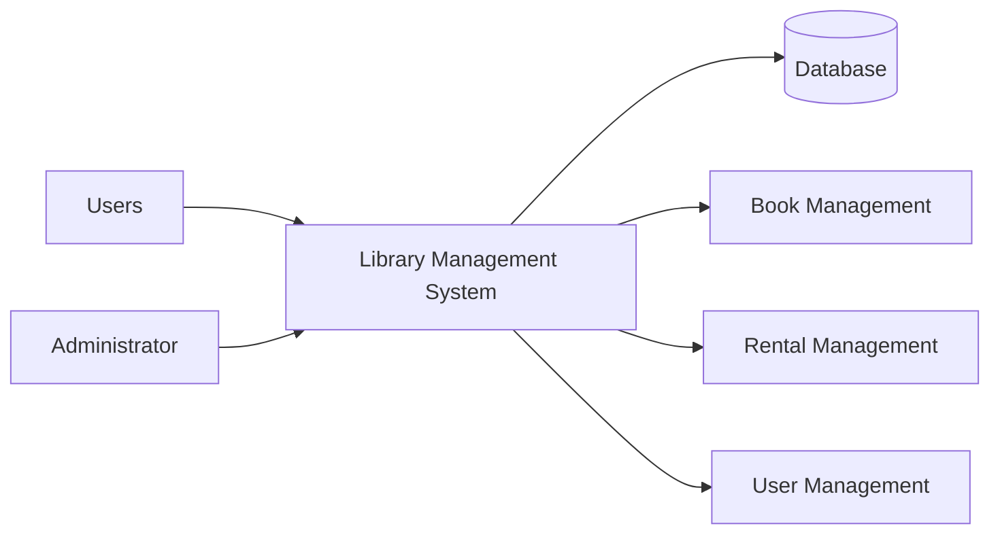
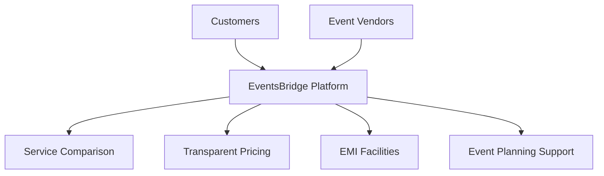
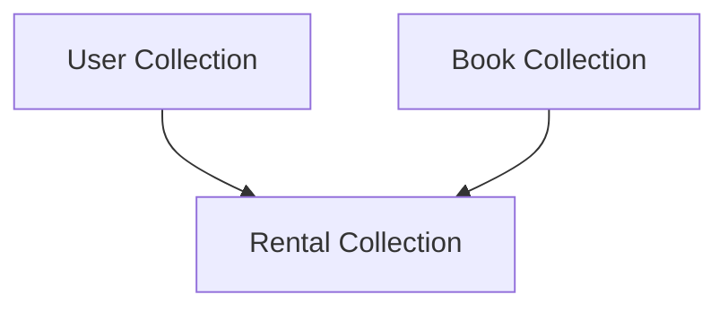

# Chapter 1: Introduction

## 1.1 Background of the Study / Activity

Technology has transformed the way organizations manage information and provide services. Many traditional systems that once relied on manual record keeping are now being replaced by digital solutions to improve efficiency, accuracy, and accessibility. Libraries are one such area where technology plays an important role in managing books, users, and transaction records.

As part of my internship in web development, I worked on the development of a **Library Management System**, a web-based application designed to automate library operations. The system was developed to manage user accounts, book records, rental information, and administrative activities through a centralized platform.

My primary involvement was in backend development, where I worked on database planning, API development, testing, debugging, and integration. The project provided practical exposure to software development processes and helped me understand how different technologies work together to create a complete web application.

The internship offered an opportunity to apply theoretical knowledge gained during academic studies in a practical environment while developing technical and professional skills.

### Project Overview

---

## 1.2 Purpose of the Internship

The internship was conducted to provide practical experience in software and web application development. It served as a bridge between academic learning and real-world implementation by allowing students to participate in an actual software project.

The internship aimed to improve technical knowledge related to databases, APIs, application development, testing, debugging, and deployment. It also provided exposure to industry practices and development workflows commonly followed in software projects.

Another important purpose was to develop problem-solving abilities and professional skills such as planning, communication, responsibility, and time management. Working on a project from the planning stage to final implementation helped in understanding the complete software development lifecycle.

---

## 1.3 Objectives of the Work

The objectives of the internship were:

* To gain practical experience in web development.
* To understand software development processes.
* To contribute to the development of a Library Management System.
* To learn database planning and API development.
* To improve testing and debugging skills.
* To gain experience in deployment and integration.
* To enhance problem-solving and analytical abilities.
* To apply academic knowledge in a real-world environment.

The successful completion of these objectives contributed significantly to my technical learning and professional growth.

---

# Chapter 2: Profile of the Organization

## 2.1 About EventsBridge

**EventsBridge** is India's first technology-driven Event Vendor Marketplace focused on empowering Tier 2 and Tier 3 cities. The organization aims to transform the event services industry into a digital, transparent, and financially inclusive ecosystem.

The platform helps customers discover trusted event vendors, compare services, evaluate pricing options, and access flexible EMI-based payment solutions. Through the use of technology and digital innovation, EventsBridge simplifies event planning and improves accessibility to professional event services.

At the same time, the platform provides vendors with opportunities to expand their reach, improve visibility, and connect with potential customers across different regions.

### EventsBridge Ecosystem

---

## 2.2 Location and General Information

**Organization Name:** EventsBridge Technology Pvt. Ltd.

**Address:** Plot No. 689/6, Near Nilakantheswar Mandir, Nayapalli, Bhubaneswar – 751012, Odisha, India.

EventsBridge operates as a technology-oriented organization that utilizes digital platforms and modern software solutions to improve service delivery in the event management industry. The organization focuses on innovation, digital transformation, and customer convenience through technology-driven solutions.

The internship was conducted over a one-month period from **08 May 2026 to 08 June 2026**. During this period, practical exposure was provided through project-based learning, allowing participants to work on software development activities and gain hands-on technical experience.

---

## 2.3 Nature of Activities and Services

EventsBridge provides a digital marketplace that connects customers with event service providers through a centralized platform. Its major services include:

* Vendor discovery and management.
* Service comparison and pricing transparency.
* Event planning support.
* EMI-based payment solutions.
* Digital platform management.
* Technology-driven customer services.
* Vendor growth and visibility support.

During the internship period, exposure to this technology-focused environment helped in understanding how modern software applications are designed, developed, tested, and deployed to solve practical business problems.

The experience provided valuable insight into real-world software development practices and contributed significantly to the successful development of the Library Management System project.

# Chapter 3: Methodology / Work Plan

## 3.1 Approach Adopted

The development of the Library Management System followed a structured and systematic approach. Before beginning the implementation phase, sufficient time was spent understanding the project requirements and identifying the major functionalities required within the application. The primary objective was to create a system capable of managing users, books, rentals, and administrative operations through a centralized web platform.

The initial stage of the project focused on planning and analysis. The requirements of the application were studied carefully to determine what information needed to be stored and how different modules would interact with one another. Since the project involved multiple entities such as users, books, and rental records, proper planning was necessary to ensure smooth development in later stages.

A backend-first development approach was adopted throughout the project. This approach was chosen because most of the application's functionality depended on efficient data storage and communication between the server and the user interface. By establishing the backend foundation first, it became easier to test and validate the core functionality before integrating it with frontend components.

The development process was divided into multiple phases. The first phase involved database planning and system architecture design. The second phase focused on API development and implementation of business logic. The third phase involved testing and debugging. Finally, frontend integration and deployment activities were completed once the backend services became stable.

This structured methodology helped ensure that development progressed in an organized manner and reduced the possibility of major design changes during later stages of implementation.

---

## 3.2 Tools and Techniques Used

Various technologies, tools, and development techniques were used during the implementation of the project.

### MongoDB Database

One of the earliest decisions during development was selecting an appropriate database system. Since the project involved storing different types of information and required flexibility during development, MongoDB was selected as the primary database solution.

MongoDB is a document-oriented NoSQL database that stores data in JSON-like documents. This structure provided flexibility while designing the application because modifications could be introduced without extensive database restructuring.

Although MongoDB does not require fixed schemas, a logical schema was designed before implementation. This helped maintain consistency across records and simplified future development and maintenance.

The major collections planned for the system included:

* User Collection
* Book Collection
* Rental Collection

These collections formed the foundation of the application's data management system.

### Node.js and Express.js

The backend of the application was developed using Node.js and Express.js.

Node.js provided a runtime environment for executing JavaScript on the server side, while Express.js simplified API creation and route management. These technologies enabled efficient handling of requests, database operations, and business logic.

API endpoints were developed to support functionalities such as:

* User registration
* User login
* User management
* Book management
* Rental management
* Dashboard operations
* Administrative functions

The API-based architecture improved modularity and allowed frontend pages to communicate efficiently with the backend services.

### Git Version Control

Version control played an important role during development. Git was used to manage project changes, maintain code history, and track modifications throughout the development lifecycle.

Using version control ensured that changes could be reviewed systematically and helped maintain project stability while introducing new features and bug fixes.

### Testing and Debugging

Testing was performed continuously during development. Every newly developed API endpoint was tested individually before integration with frontend pages.

Special attention was given to:

* User authentication functionality
* Database operations
* Rental calculations
* Dashboard information
* Data retrieval processes

Whenever issues were discovered, debugging techniques were applied to identify root causes and implement suitable solutions.

### Cloud Services and Deployment

Cloud-based services were utilized for database hosting and application deployment. Hosting allowed the application to be tested in a real-world environment rather than only on local systems.

Deployment activities helped identify issues that were not visible during local development and contributed to improving application reliability.

---

## 3.3 Database Planning Methodology

Database planning was one of the most important stages of development. Before implementation began, the required data entities were identified and organized logically.

The database structure was designed to support user accounts, books, rentals, and administrative activities. Relationships between different entities were analyzed to ensure efficient data retrieval and management.

The simplified database structure can be represented as follows:

The User Collection stored account-related information such as names, email addresses, account status, and profile information.

The Book Collection stored information related to books, including book names, subjects, pricing details, and availability.

The Rental Collection maintained records of rented books, user references, due dates, and return status information.

This structure allowed the system to maintain organized records while supporting future scalability.

---

## 3.4 Planning and Execution of Activities

The project was executed through multiple development phases.

### Requirement Analysis Phase

The internship began with understanding project requirements and identifying the major functionalities required within the Library Management System.

During this phase, the application workflow was studied and the major modules were identified. This provided a clear understanding of what needed to be developed.

### System Design Phase

After requirement analysis, the overall architecture of the application was planned.

Major considerations included:

* Database structure
* API architecture
* User authentication flow
* Rental management process
* Dashboard functionality

The design phase helped establish a clear roadmap for development activities.

### API Development Phase

Once planning was completed, development of API endpoints began.

Initially, user-related functionalities were implemented and tested. These included registration, login, and user management operations.

As development progressed, additional endpoints were created for book management, rental tracking, dashboard information, and administrative operations.

The API workflow can be represented as:

This architecture allowed the frontend and backend components to remain independent while communicating efficiently through APIs.

### Integration Phase

After successful testing of individual endpoints, frontend integration activities were started.

API endpoints were connected to corresponding pages and tested to verify proper communication between the user interface and backend services.

This phase involved validating user registration, login functionality, dashboard information, book operations, and rental management features.

### Deployment and Troubleshooting Phase

Following integration, deployment activities were performed.

During deployment, certain issues were encountered when the frontend and backend were hosted on separate services. Because both components operated from different origins, communication restrictions affected API requests.

To resolve this issue, proper Cross-Origin Resource Sharing (CORS) configuration was implemented, allowing the frontend application to communicate successfully with backend services.

Additional troubleshooting activities were performed to identify and resolve bugs, improve application stability, and ensure smooth functionality across different modules.

### Final Testing Phase

The final phase involved comprehensive testing of the complete application.

All major functionalities were tested, including:

* User registration and login
* Book management
* Rental management
* Dashboard operations
* Administrative functionality
* API communication
* Database interactions

This testing process ensured that the system functioned correctly and that all major objectives of the project had been achieved.

---

## 3.5 Outcome of the Methodology

The adopted methodology provided a systematic framework for developing the Library Management System. By beginning with planning and database design before moving into implementation, development activities remained organized and efficient.

The use of MongoDB, Node.js, Express.js, Git, testing procedures, and cloud deployment services contributed significantly to the successful completion of the project. The methodology also helped in reducing development errors, improving maintainability, and ensuring that the application met its intended objectives.

Through this approach, practical knowledge was gained regarding project planning, database management, API development, testing, debugging, deployment, and software maintenance, making the internship a valuable learning experience.

