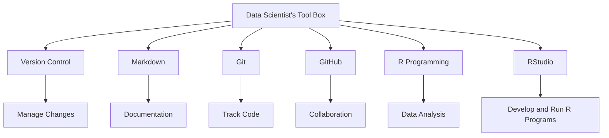
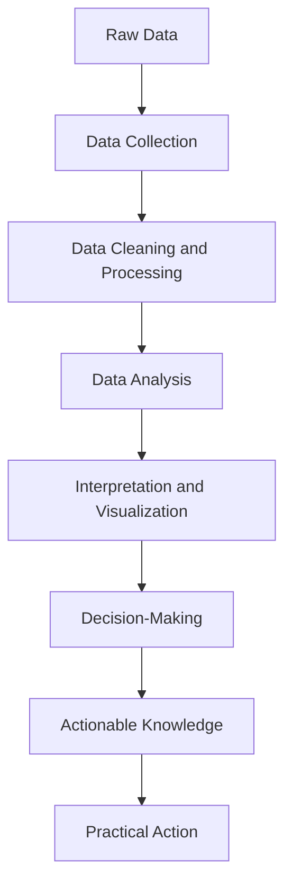

# Q1 – Explain the Data Scientist's Tool Box.

## Answer

### 1. Introduction

A Data Scientist's Tool Box refers to the collection of tools, software and technologies used by data scientists to collect, organize, analyze, visualize and interpret data.

A data scientist works with large amounts of data to find useful information and solve real-world problems. Different tools are used at different stages of data analysis. These tools make the work easier, faster and more accurate.

Some important tools used in data science are Version Control, Markdown, Git, GitHub, R and RStudio.

### 2. Important Tools Used in Data Science

1\. Version Control

Version control is a system used to track and manage changes made to files and programs over time.

- It helps developers maintain different versions of a project.
- It allows users to return to an earlier version if an error occurs.
- It helps multiple people work on the same project.
- It prevents the loss of important code and information.

Example: If a data scientist makes a mistake while modifying a program, version control helps restore the previous working version.

2\. Markdown

Markdown is a simple formatting language used to create properly organized documents using plain text.

- It is used to create headings, lists, tables and links.
- It makes technical documents easy to read.
- It is commonly used in project reports and documentation.
- It helps explain code and analysis results.

Example: Data scientists use Markdown in Jupyter Notebooks and project documentation to explain their work.

3\. Git

Git is a free and open-source version control system used to track changes in source code and project files.

Its important features are:

- It tracks changes made to files.
- It allows users to create different branches.
- It helps developers work together.
- It allows users to restore previous versions.
- It maintains a history of project changes.

Example: A data scientist uses Git to save and manage different versions of a data analysis project.

4\. GitHub

GitHub is an online platform used to store, manage and share projects that use Git.

Its important features are:

- It provides online storage for project repositories.
- It allows multiple developers to collaborate.
- It helps users share their code with others.
- It provides issue tracking and project management.
- It allows users to review and discuss code changes.

Example: A team of data scientists can upload their project to GitHub and work together from different locations.

5\. R Programming Language

R is a programming language specially designed for statistical computing, data analysis and graphical representation.

Its important features are:

- It supports statistical calculations.
- It provides tools for data manipulation.
- It creates graphs and charts.
- It supports machine learning techniques.
- It has many packages for data analysis.

Example: R can be used to analyze sales data and create graphs to understand business performance.

6\. RStudio

RStudio is an Integrated Development Environment (IDE) used for writing and running R programs.

Its important features are:

- It provides a code editor for writing R programs.
- It has a console for executing commands.
- It displays graphs and visualizations.
- It helps manage files and projects.
- It provides tools for debugging and package management.

Example: A data scientist can write an R program in RStudio, execute it and view the results in the same environment.

### 3. Diagram of Data Scientist's Tool Box



### 4. Advantages of Data Science Tools

1. Saves Time: These tools make data analysis faster and easier.
2. Improves Accuracy: They help reduce errors during data processing and analysis.
3. Easy Collaboration: Tools like Git and GitHub allow teams to work together.
4. Better Documentation: Markdown helps organize and explain project information.
5. Efficient Analysis: R and RStudio provide powerful facilities for statistical analysis and visualization.
6. Project Management: Version control helps maintain and manage project changes.

### 5. Conclusion

The Data Scientist's Tool Box contains important tools that help in developing and managing data analysis projects. Tools like Git and GitHub support version control and collaboration, Markdown helps in documentation, and R and RStudio are used for statistical analysis and programming. Together, these tools make data science work more organized, efficient and reliable. Therefore, knowledge of these tools is important for every data scientist.


# Q2 – Explain the Process of Turning Data into Actionable Knowledge.

## Answer

### 1. Introduction

Turning data into actionable knowledge is one of the most important processes in Data Science. It refers to converting raw data into meaningful information that can be used to make better decisions and solve real-world problems.

Raw data alone is not very useful because it may contain numbers, names, dates, records and other unorganized information. By collecting, cleaning, processing and analyzing this data, we can discover useful patterns and understand different situations.

For example, a shopping company collects information about customer purchases, product prices and customer preferences. By analyzing this information, the company can identify popular products and decide which products should be stocked more frequently.

The process involves several important steps.

### 2. Steps Involved in Turning Data into Actionable Knowledge

#### Step 1: Data Collection

Data collection is the first step. It means gathering the required data from different sources according to the problem being studied.

Data can be collected from:
- Websites and online applications.
- Surveys and questionnaires.
- Sensors and machines.
- Business records and databases.
- Social media platforms.

For example, a shopping company collects information about customer purchases, product prices and customer feedback. This collected data becomes the foundation for further analysis.

#### Step 2: Data Cleaning and Processing

After collecting data, it may contain errors, missing values, duplicate records or unnecessary information. Such data cannot always be used directly.

Therefore, data cleaning and processing are performed to improve the quality of the data.

This step includes:
- Removing duplicate records.
- Correcting incorrect values.
- Handling missing data.
- Removing unnecessary information.
- Organizing data into a proper format.

For example, if a customer record does not contain an age or contains an incorrect value, the data scientist checks and handles that problem before analysis.

Clean and organized data helps produce more reliable results.

#### Step 3: Data Analysis

Data analysis means examining the processed data to discover useful information, patterns, relationships and trends.

Data scientists use statistical methods, programming languages and analytical tools to understand the data.

For example, a shopping company may analyze its sales records to find:
- Which product sells the most.
- Which month has the highest sales.
- Which customers purchase frequently.
- Which products have low demand.

Tools such as R, Python and other data analysis software help perform these tasks.

#### Step 4: Data Interpretation and Visualization

After analysis, the results must be understood and presented in a meaningful way. This process is called data interpretation.

Data visualization means presenting information using graphs, charts and tables so that people can understand the results easily.

For example, a bar chart can show which product has the highest sales, while a line graph can show how sales change over time.

Interpretation helps convert analytical results into meaningful conclusions.

#### Step 5: Decision-Making and Taking Action

This is the final and most important step. The knowledge obtained from data analysis is used to make decisions and take practical actions.

For example, if the analysis shows that a particular product is selling quickly, the company can increase its stock. If another product has low demand, the company may reduce its production or offer discounts.

Thus, data becomes useful when its results are applied to real-world situations.

### 3. Flowchart of the Process



### 4. Importance of Turning Data into Actionable Knowledge

1. Better Decision-Making: It helps organizations make decisions based on facts rather than guesses.
2. Problem-Solving: It helps identify problems and find suitable solutions.
3. Improved Efficiency: It helps save time, money and resources.
4. Understanding Trends: It helps identify patterns and predict future possibilities.
5. Business Growth: It helps organizations understand customer needs and improve their services.

### 5. Conclusion

Turning data into actionable knowledge is an important process in Data Science. It starts with collecting raw data and continues through cleaning, processing, analysis, interpretation and decision-making. Each step plays an important role in converting unorganized data into meaningful knowledge. Finally, this knowledge is used to take practical actions and solve real-world problems. Therefore, the main goal of Data Science is not just to collect or analyze data, but to use it to make better decisions.


# Q3 – Explain Version Control and Git. Discuss Their Importance in Data Science.

## Answer

### 1. Introduction

In Data Science, data scientists work with different types of files, such as program code, datasets, reports and project documents. During a project, these files are modified many times. Sometimes, a new change may introduce errors or produce unexpected results. It can also become difficult for multiple people to work on the same project.

To manage these problems, data scientists use **Version Control Systems (VCS)** and tools like **Git**.

Version control and Git help users track changes, maintain previous versions of files, recover lost work and collaborate with other team members. They make data science projects more organized, reliable and easier to manage.

### 2. What is Version Control?

Version control is a system used to record, track and manage changes made to files over time.

In simple words, it keeps a history of a project's development. Whenever a user makes an important change, version control can save that change as a new version.

For example, suppose a data scientist is developing a program to analyze sales data. Initially, the program works correctly. Later, the data scientist modifies the code to add a new feature, but the modification creates an error.

Without version control, it may be difficult to recover the earlier working code. However, with version control, the data scientist can return to a previous version and continue working.

**Important features of version control:**

- **Change Tracking:** It records the changes made to project files.
- **Version History:** It maintains a history of previous versions.
- **Recovery:** It allows users to restore an earlier version when something goes wrong.
- **Collaboration:** It allows multiple people to work on the same project.
- **Organization:** It helps maintain project files in a systematic way.

### 3. What is Git?

Git is a free and open-source Distributed Version Control System (DVCS) used to track changes in files and manage software development projects.

It was created by Linus Torvalds in 2005. Git allows developers and data scientists to save different versions of their work and collaborate with other people.

Unlike a system that depends entirely on one central server, Git allows every team member to maintain a complete copy of the project's version history on their own computer.

**Important features of Git:**

1. **Repository:** A repository is a storage location where project files and their version history are maintained.

2. **Commit:** A commit is a saved record of changes made to a project. It allows users to understand what was changed and when.

3. **Branching:** A branch allows users to work on a new feature or experiment without directly changing the main version of the project.

4. **Merging:** Merging combines changes from different branches into one branch.

5. **Distributed System:** Every user can maintain a local copy of the repository and its history.

6. **Reverting Changes:** Git allows users to undo unwanted changes and return to an earlier working state.

### 4. How Git Works

Git follows a simple process. First, a user creates or initializes a repository. Then, project files are added to Git. Whenever changes are made, the user can save them using commits.

If a new feature is required, the user can create a separate branch, work on it and later merge it into the main branch.

The basic workflow is shown below:

```mermaid
flowchart TD
    A["Create or Initialize Repository"] --> B["Add Project Files"]
    B --> C["Make Changes"]
    C --> D["Stage Changes"]
    D --> E["Commit Changes"]
    E --> F{"More Work Required?"}
    F -->|Yes| C
    F -->|No| G["Project Version Saved"]
````

### 5. Importance of Version Control and Git in Data Science

Version control and Git are very useful in data science because data science projects involve continuous experimentation, programming and modification of files.

1\. Tracking Changes: Data scientists frequently modify their programs and analysis methods. Git records these changes, making it easier to understand how a project has developed.

2\. Recovering Previous Work: Sometimes, a new change may produce incorrect results. Git allows users to return to an earlier working version without losing their entire project.

3\. Team Collaboration: Multiple data scientists can work on the same project. They can develop different features independently and combine their work later.

4\. Managing Experiments: Data scientists often try different methods to find the best solution. Git helps maintain different versions of their code so that experiments can be compared.

5\. Maintaining Project History: Git stores a history of commits, helping users understand who made a change and why it was made.

6\. Protecting Project Work: Keeping a remote copy of a Git repository can provide an additional way to access project files if the local computer is damaged.

### 6. Advantages of Git

- It is free and open-source.
- It works quickly and efficiently.
- It maintains a complete history of changes.
- It supports teamwork and collaboration.
- It allows users to experiment using branches.
- It helps recover previous versions of a project.

### 7. Conclusion

Version control is an important part of data science because it helps manage and track changes made to project files. Git is one of the most widely used version control systems. It provides features such as repositories, commits, branching and merging, which make project management easier.

Therefore, version control and Git help data scientists maintain organized projects, avoid losing important work, manage experiments and collaborate effectively with other team members.


# Q4 – What is GitHub? Explain its Features, Advantages and Role in Data Science Projects.

## Answer

### 1. Introduction

GitHub is an online platform used to store, manage, share and collaborate on programming projects. It is based on Git, which is a version control system used to track changes made to files over time.

In simple words, Git helps us track changes in a project, whereas GitHub provides an online platform where we can store our Git repositories and work with other people.

GitHub is widely used by software developers and data scientists to manage their projects, share code and work together as a team.

For example, suppose a group of data scientists is developing a project to analyze customer shopping behaviour. They can create a GitHub repository, upload their Python or R programs, share datasets and allow other team members to contribute to the project.

### 2. What is a GitHub Repository?

A repository, commonly called a repo, is a storage location where all the files related to a project are maintained.

A GitHub repository can contain:
- Source code and programming files.
- Project documentation.
- Data analysis reports.
- Images, graphs and other resources.
- A history of changes made to the project.

Repositories can be **Public** or **Private**.

- **Public Repository:** Anyone can view the repository and access its contents.
- **Private Repository:** Only authorized users can access the repository.

For example, a data scientist can create a repository named `Sales-Data-Analysis` to store programs, reports and documentation related to a sales analysis project.

### 3. Important Features of GitHub

GitHub provides several features that make project development and management easier.

**1. Repositories**

Repositories are used to store project files, source code and documentation in one place. They also maintain the project's version history through Git.

**2. Collaboration**

GitHub allows multiple users to work on the same project. Team members can contribute their code, suggest improvements and review the work of others.

**3. Pull Requests**

A Pull Request is a feature that allows users to propose changes to a project. Other team members can review the changes, discuss them and approve them before they are merged into the main project.

**4. Issues**

Issues are used to report bugs, suggest new features and discuss problems related to a project. They help teams organize and track their work.

**5. Branching**

Branches allow users to work on new features or make changes without directly modifying the main version of the project. Once the work is completed, the changes can be merged.

**6. README File**

A README file contains important information about a project, such as its purpose, installation instructions, tools used and how to run the program.

**7. GitHub Actions**

GitHub Actions helps automate certain tasks in a project, such as testing code and running development workflows.

### 4. How GitHub Works

GitHub works together with Git. First, a user creates a repository and uploads project files. Other team members can download or clone the repository to their computers.

They can make changes, save them using Git commits and push their changes to GitHub. If they want to contribute changes to the main project, they can create a Pull Request.

The basic working process is shown below:

```mermaid
flowchart TD
    A["Create GitHub Repository"] --> B["Upload Project Files"]
    B --> C["Team Members Clone Repository"]
    C --> D["Make Changes Using Git"]
    D --> E["Commit and Push Changes"]
    E --> F["Create Pull Request"]
    F --> G["Review Changes"]
    G --> H["Merge Changes into Main Project"]
````

### 5. Advantages of GitHub

1. Easy Sharing: Users can share their projects and code with other people.
2. Team Collaboration: Multiple developers can contribute to the same project.
3. Version Management: GitHub maintains project history through Git, making it easier to track and manage changes.
4. Backup: It provides online storage for project files, allowing users to access their work from different computers.
5. Open-Source Development: Users can publish public projects and allow others to contribute.
6. Project Organization: Features like Issues and Pull Requests help organize tasks and manage project development.
7. Accessibility: Projects can be accessed through the internet from different locations, subject to repository permissions.

### 6. Role of GitHub in Data Science Projects

GitHub plays an important role in data science because data science projects involve programming, experimentation, data analysis and documentation.

- Code Sharing: Data scientists can share their R and Python programs with other researchers and team members.
- Project Management: They can maintain project files, reports and documentation in one repository.
- Teamwork: Different team members can work on separate parts of a project and combine their work.
- Experiment Tracking: Git helps maintain different versions of analysis code, making it easier to compare experiments.
- Reproducibility: Project code and documentation can help other people understand and repeat the analysis.
- Portfolio Development: Data scientists can showcase their projects on GitHub to demonstrate their programming and analytical skills.

### 7. Conclusion

GitHub is an important platform for storing, managing and sharing programming projects. It works with Git and provides features such as repositories, branching, Pull Requests, Issues and collaboration tools.

In Data Science, GitHub helps data scientists organize their projects, share code, manage experiments and work with other team members. Therefore, GitHub makes data science project development more organized, collaborative and efficient.

# Q5 – Explain R and RStudio. Discuss Their Features and Importance in Building Data Analysis Software.

## Answer

### 1. Introduction

In Data Science, programming languages and software tools are used to collect, organize, analyze and visualize data. Two important tools used for this purpose are **R and RStudio**.

R is a programming language mainly designed for statistical computing, data analysis and graphical representation. It provides different functions and packages that help data scientists perform calculations, analyze large datasets and create visualizations.

RStudio is an Integrated Development Environment (IDE) used for writing, executing, testing and managing R programs. It provides a user-friendly working environment where programmers can write code and view results easily.

In simple words, **R is the programming language, while RStudio is the software environment used to work with R efficiently.**

### 2. What is R Programming Language?

R is a free and open-source programming language used for statistical analysis, data manipulation and data visualization.

It is widely used by data scientists, statisticians, researchers and analysts to understand data and solve different analytical problems.

For example, a company can use R to analyze its monthly sales records, calculate average sales, identify business trends and create graphs to understand its performance.

#### Important Features of R

1. **Statistical Analysis:** R provides built-in functions for calculating mean, median, standard deviation, correlation and other statistical measurements.

2. **Data Manipulation:** It provides functions and packages to organize, filter, sort and modify datasets.

3. **Data Visualization:** R can create different types of graphs, such as bar charts, pie charts, histograms and line graphs.

4. **Packages and Libraries:** R supports many packages that provide additional features for data analysis, machine learning and visualization.

5. **Open Source:** R is freely available, and users can modify and use it according to their requirements.

6. **Platform Independent:** R can run on different operating systems, including Windows, Linux and macOS.

### 3. What is RStudio?

RStudio is an Integrated Development Environment (IDE) that provides a convenient environment for writing and executing R programs.

It makes working with R easier because it combines different programming tools into a single application.

For example, instead of writing code in one application and checking the output in another, a data scientist can write R code, execute it and view graphs in RStudio itself.

#### Important Features of RStudio

1. **Source Code Editor:** It provides an editor where users can write, modify and save R programs.

2. **Console:** The console is used to execute R commands and display their output.

3. **Environment Pane:** It displays variables, datasets and objects currently stored in memory.

4. **Plots Pane:** It displays graphs and visualizations created using R.

5. **Package Management:** It allows users to install, update and manage different R packages.

6. **File Management:** It helps users browse and manage project files and folders.

7. **Debugging Support:** It provides tools to identify and correct errors in R programs.

### 4. Difference Between R and RStudio

| R | RStudio |
|---|---|
| R is a programming language. | RStudio is an IDE. |
| It is used for statistical computing and data analysis. | It provides an environment for writing and running R programs. |
| It provides functions for calculations and data manipulation. | It provides an editor, console and other development tools. |
| It can be used through its console. | It makes working with R more convenient. |
| It is the language used to perform operations. | It helps users develop and manage R projects. |

### 5. How R and RStudio Work Together

R and RStudio work together to make data analysis easier.

First, the user opens RStudio and writes an R program in the source code editor. The program is executed using the R engine. The output is displayed in the console, while graphs and charts appear in the plots pane.

For example, a data scientist can use RStudio to write a program that calculates the average marks of students and displays the result.

The following diagram explains their relationship:

```mermaid
flowchart TD
    A["User Opens RStudio"] --> B["Writes R Program"]
    B --> C["R Executes the Program"]
    C --> D["Processes and Analyzes Data"]
    D --> E["Displays Results"]
    E --> F["Console, Tables and Graphs"]
````

### 6. Importance of R and RStudio in Building Data Analysis Software

R and RStudio play an important role in developing data analysis software because they provide the tools needed to process data and generate meaningful results.

1\. Easy Data Analysis: R provides statistical functions that help data scientists analyze datasets and understand important information.

2\. Better Data Visualization: R helps create graphs and charts, making complex information easier to understand.

3\. Faster Development: RStudio provides an organized environment where users can write, execute and manage programs in one place.

4\. Handling Large Datasets: R provides data manipulation tools and packages that help users work with large amounts of data.

5\. Machine Learning Support: R provides packages that can be used to develop machine learning models and perform predictive analysis.

6\. Reusable Code: Data scientists can write functions and save programs that can be reused in different projects.

7\. Research and Business Applications: R and RStudio are used in research, healthcare, finance, education and business analytics.

### 7. Advantages of R and RStudio

- Both are widely used in data analysis and research.
- R is free and open-source.
- R provides a large collection of statistical and visualization packages.
- RStudio makes programming easier through its user-friendly interface.
- They support data analysis, visualization and machine learning.
- They help organize and manage data science projects.

### 8. Conclusion

R and RStudio are important tools in Data Science. R is a programming language used for statistical computing, data manipulation and visualization, whereas RStudio is an IDE that provides a convenient environment for developing and executing R programs.

Together, they help data scientists analyze data, create visualizations, develop analytical solutions and build data analysis software efficiently. Therefore, R and RStudio are valuable tools for data analysis and scientific research.
